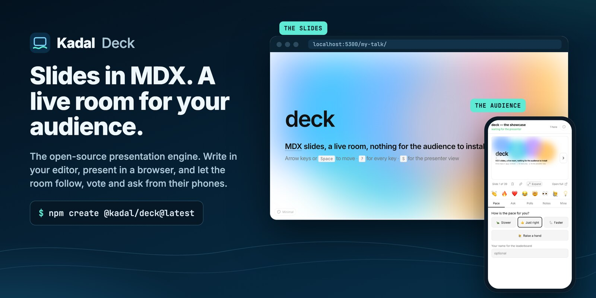
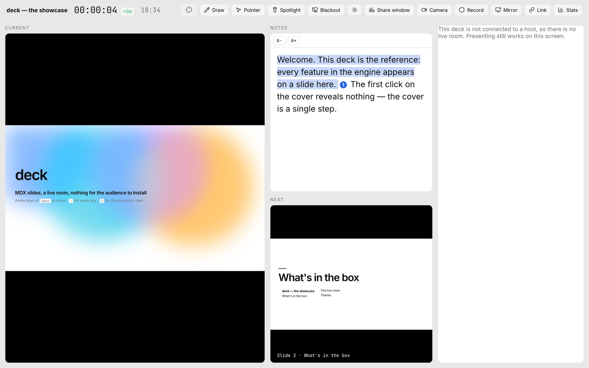
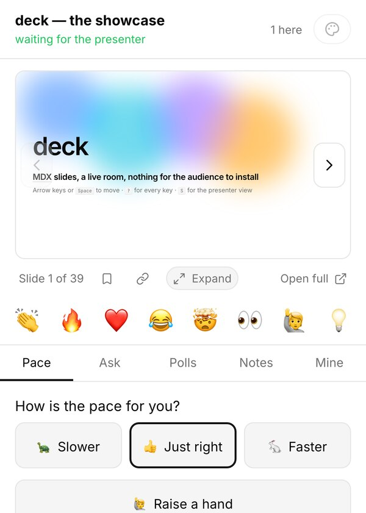

<p align="center">
  <a href="https://deck.kadal.cc">
    
  </a>
</p>

<h1 align="center">Kadal Deck</h1>

<p align="center">
  <strong>Slides in MDX. A live room for your audience. One command to publish.</strong><br>
  Write the talk in the editor you already use, present it in a browser, and let the room follow,<br>
  react, ask and vote from their phones — nothing for them to install.
</p>

<p align="center">
  <a href="https://www.npmjs.com/package/@kadal/deck"></a>
  <a href="https://www.npmjs.com/package/@kadal/deck"></a>
  <a href="https://github.com/kadalcc/deck/actions/workflows/ci.yml"></a>
  <a href="https://github.com/kadalcc/deck/releases"></a>
  <a href="LICENSING.md"></a>
  <a href="https://www.npmjs.com/package/@kadal/deck"></a>
  <br>
  <a href="https://deck.kadal.cc"></a>
  <a href="https://deck.kadal.cc/tour/"></a>
  <a href="https://deck.kadal.cc/docs/"></a>
  <a href="https://github.com/sponsors/pmithunish"></a>
</p>

<p align="center">
  <a href="https://deck.kadal.cc/docs/getting-started/">Get started</a> ·
  <a href="https://deck.kadal.cc/docs/">Docs</a> ·
  <a href="https://deck.kadal.cc/tour/">Live demo</a> ·
  <a href="https://deck.kadal.cc/showcase/">Showcase</a> ·
  <a href="https://deck.kadal.cc/changelog/">Changelog</a> ·
  <a href="https://deck.kadal.cc/sponsor/">Sponsor</a>
</p>

---

## Why Kadal Deck

- **You write; it presents.** A talk is one `deck.mdx` file: Markdown, plus components when you
  need them. It lives in git, diffs cleanly and reloads as you type.
- **The room is part of the deck.** Your audience scans a QR code and follows along on their
  phones: reactions, questions with upvotes, polls, word clouds, timed quizzes, a pace dial and a
  raised hand, all built in. No add-on, no second app.
- **Any framework on a slide.** React and web components out of the box; Vue, Svelte, Solid,
  Preact, Qwik, Angular, Fresh, Rust/WebAssembly and Python as islands, each loaded only when its
  slide appears.
- **Familiar keys.** Slides split at `---` and `----` the way reveal.js and Slidev do, the
  presenter view opens on `S`, and the keyboard is vim-first.
- **Yours to run.** A built deck is a static site that works offline. Export it to PDF, PNG or
  PPTX, host it anywhere, or publish it with a live room in one command.

## Quick start

You need **Node 20.19+** and npm, pnpm, Yarn or Bun.

```sh
npm create @kadal/deck@latest my-talk
cd my-talk && npm install
npm run dev                  # edit deck.mdx; the slide you're on updates in place
```

```mdx
---
title: Hello, room
---

# Hello, room

---

## Clicks, one point at a time

<Clicks>

- Slides split at `---`, vertical ones at `----`
- Code steps line by line, and notes follow your clicks

</Clicks>

---

<Poll id="lunch" question="Lunch?" options={["Dosa", "Biryani", "Both"]} />
```

When it's ready:

```sh
npx kadal-deck build         # dist/ for any static host (everything but the live room)
npx kadal-deck export        # PDF in export/; add --png --pptx for those too
npx kadal-deck publish       # deck.kadal.cc/@you/my-talk/ with a live room (free plan)
```

## See it

<table>
<tr>
<th width="70%">The presenter view</th>
<th width="30%">The audience, on a phone</th>
</tr>
<tr>
<td valign="top"></td>
<td valign="top"></td>
</tr>
<tr>
<td valign="top">Current and next slide, notes that follow your clicks, a timer with pacing, drawing, laser, spotlight, blackout, a frameless share window for calls, and the room panel.</td>
<td valign="top">The slide in step with you (or roam ahead and catch up), reactions, questions, polls, quizzes, pace and a raised hand.</td>
</tr>
</table>

**[Open the tour →](https://deck.kadal.cc/tour/)**: the engine's own feature deck, with every
framework island running on one slide. Press `?` for the keys.

## Features

<table>
<tr>
<td valign="top" width="50%">

**Authoring**

- MDX with clicks (`<Click>`, `<Clicks>`, `at="+2"`), layouts and named slots
- Code that steps line by line, Shiki highlighting, magic move
- KaTeX maths and Mermaid diagrams
- Excalidraw sketches drawn in code, with guided steps
- Glossary term cards: the compiler links the first mention of each term
- 14 layouts, 30+ backgrounds (aurora, starfield, a wire globe…), transitions,
  auto-animate and motion

</td>
<td valign="top" width="50%">

**Presenting**

- Presenter view with notes, timer, next slide and tools
- A frameless share window for video calls; a projector mode that ignores stray input
- Overview, search, jump to slide, zoom, drawing, laser, spotlight, blackout
- Vim keys and Vimium-style `f` hints for everything clickable
- The same slide at any window size: authored at 1920 × 1080 and scaled, never reflowed

</td>
</tr>
<tr>
<td valign="top">

**The live room**

- The audience follows on their phones, or roams and catches up with one button
- Reactions, questions with upvotes, polls, ratings, word clouds, timed quizzes and a leaderboard
- Pace feedback and raised hands in the presenter's room panel
- Your drawings, confetti and shared term cards on every screen

</td>
<td valign="top">

**Shipping it**

- `kadal-deck build`: a static site for any host, working offline
- `kadal-deck export`: PDF, PNG and PPTX (one image per slide, notes attached)
- `kadal-deck publish`: hosted with a live room, analytics, passcodes and share links
- Publishes from CI with an API token; only changed files are uploaded

</td>
</tr>
</table>

## Islands, in any framework

Put a component from any of these on a slide. Each runtime is code-split and loads only when its
slide appears; [`examples/showcase`](examples/showcase) runs all eleven on one slide.

| Framework | Package | | Framework | Package |
| --- | --- | --- | --- | --- |
| React | built in | | Qwik | [`@kadal/deck-qwik`](packages/deck-qwik) |
| Web components | built in | | Angular | [`@kadal/deck-angular`](packages/deck-angular) |
| Vue | [`@kadal/deck-vue`](packages/deck-vue) | | Fresh | [`@kadal/deck-fresh`](packages/deck-fresh) |
| Svelte | [`@kadal/deck-svelte`](packages/deck-svelte) | | WebAssembly / Rust (Leptos, …) | [`@kadal/deck-wasm`](packages/deck-wasm) |
| Solid | [`@kadal/deck-solid`](packages/deck-solid) | | Python (Pyodide) | [`@kadal/deck-python`](packages/deck-python) |
| Preact | [`@kadal/deck-preact`](packages/deck-preact) | | | |

## Packages

| Package | Version | What it is |
| --- | --- | --- |
| [`@kadal/deck`](packages/deck) | [](https://www.npmjs.com/package/@kadal/deck) | The engine: MDX compiler and Vite plugin, React runtime, components, themes, live client, export, and the `kadal-deck` CLI |
| [`@kadal/create-deck`](packages/create-deck) | [](https://www.npmjs.com/package/@kadal/create-deck) | `npm create @kadal/deck@latest`: a new deck from the starter |
| `@kadal/deck-*` | [](https://www.npmjs.com/org/kadal) | The framework renderers above, released in lockstep with the engine |

Every package is published from this repository's [release workflow](.github/workflows/release.yml)
through npm trusted publishing, with [provenance](https://docs.npmjs.com/generating-provenance-statements)
you can check on each npm page.

## The live room: self-hosted or hosted

Everything one machine can do is free and stays free: writing, presenting, the presenter view,
export and a static build. The **live room** needs a server that holds a WebSocket per deck.

- **Host it yourself.** The room protocol is typed in the engine (`@kadal/deck/protocol`) and
  [documented endpoint by endpoint](https://deck.kadal.cc/docs/self-hosting/), so a room server
  you write against it can't drift from the client.
- **Or use [deck.kadal.cc](https://deck.kadal.cc).** `npx kadal-deck publish` gives the deck a
  live room, analytics, passcodes, version history and teams. There's a
  [free plan](https://deck.kadal.cc/pricing/), and the paid plans fund the engine, the way
  Slides.com funds reveal.js.

## Documentation

| | |
| --- | --- |
| [Getting started](https://deck.kadal.cc/docs/getting-started/) | Create a deck and learn what each file is for |
| [Writing slides](https://deck.kadal.cc/docs/writing-slides/) | Slides, frontmatter, layouts and slots |
| [Clicks and animation](https://deck.kadal.cc/docs/clicks-and-animation/) | Steps, auto-animate, motion and transitions |
| [Code](https://deck.kadal.cc/docs/code/) | Line steps, magic move and highlighting |
| [The live room](https://deck.kadal.cc/docs/live-room/) | Polls, quizzes, questions, pace and following |
| [Islands](https://deck.kadal.cc/docs/islands/) | Components from other frameworks |
| [Presenter and keyboard](https://deck.kadal.cc/docs/presenter-and-keyboard/) | Every view and every key |
| [Export](https://deck.kadal.cc/docs/export/) | PDF, PNG and PPTX |
| [CLI](https://deck.kadal.cc/docs/cli/) | `dev`, `build`, `export`, `login`, `publish` |
| [Self-hosting the room](https://deck.kadal.cc/docs/self-hosting/) | The protocol and what the AGPL asks of you |

The engine's own reference, with every component and option, is in
[`packages/deck/README.md`](packages/deck/README.md).

## Sponsors

Kadal Deck is made by [@pmithunish](https://github.com/pmithunish), an independent developer in Chennai
working as [Kadal](https://kadal.cc). Sponsorships go straight to the maintainer and pay for time on
the open-source engine: issues, docs, new islands and the features you ask for.
**[Become a sponsor →](https://github.com/sponsors/pmithunish)**

| Tier | A month | What you get |
| --- | --- | --- |
| Supporter | $3 | Our thanks and the sponsor badge on your GitHub profile |
| Backer | $10 | Your name in [BACKERS.md](BACKERS.md) and on [the sponsor page](https://deck.kadal.cc/sponsor/) |
| Patron | $25 | Your avatar in this README and on the sponsor page |
| Bronze | $100 | Your company's logo in this README and on the sponsor page |
| Silver | $250 | A larger logo here, on the sponsor page and in the docs |
| Gold | $500 | The largest logo at the top of this README and the docs, priority on your issues, and a monthly call |

One-time sponsorships of $10 and $50 are welcome too. Companies can sponsor
[by invoice](https://docs.github.com/en/sponsors/sponsoring-open-source-contributors/paying-for-github-sponsors-by-invoice).

<!-- sponsors: Gold, Silver and Bronze logos and Patron avatars go here, largest first -->
<p align="center">
  <a href="https://github.com/sponsors/pmithunish"><strong>Your logo here</strong></a> —
  be the first company to sponsor Kadal Deck.
</p>
<!-- /sponsors -->

## Contributing

Bug reports with a small `deck.mdx` that reproduces them are the most useful thing you can send,
and pull requests are welcome. [CONTRIBUTING.md](CONTRIBUTING.md) covers the setup (Bun 1.3+),
the tests and the island verifier. Please follow the [code of conduct](CODE_OF_CONDUCT.md), and
report security issues privately as [SECURITY.md](SECURITY.md) describes.

<a href="https://github.com/kadalcc/deck/graphs/contributors">
  
</a>

## Licence

**[AGPL-3.0-or-later](LICENSE)**, with a commercial licence for anyone who wants to build a hosted
or proprietary product on the engine without publishing their changes. Presenting with it,
self-hosting your own decks or embedding a deck in a site you publish triggers nothing. The
details are in [LICENSING.md](LICENSING.md).

<p align="center">
  <sub>Made in Chennai by <a href="https://kadal.cc">Kadal</a> · <a href="https://deck.kadal.cc">deck.kadal.cc</a></sub>
</p>
