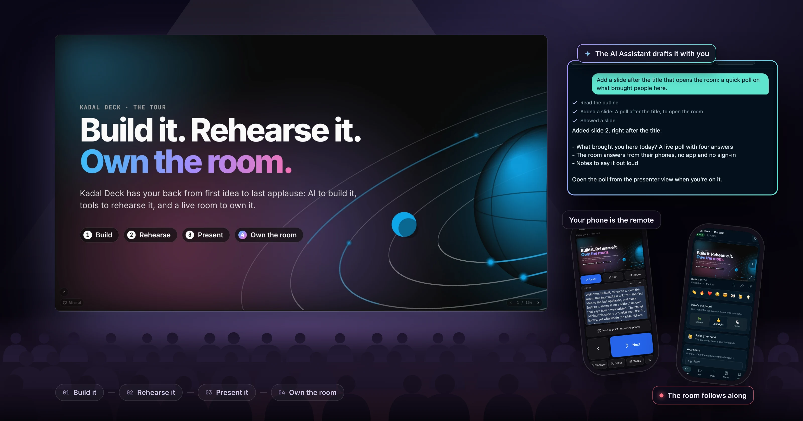
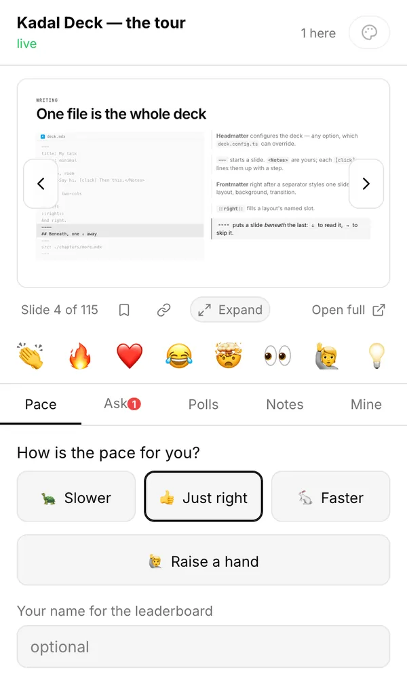
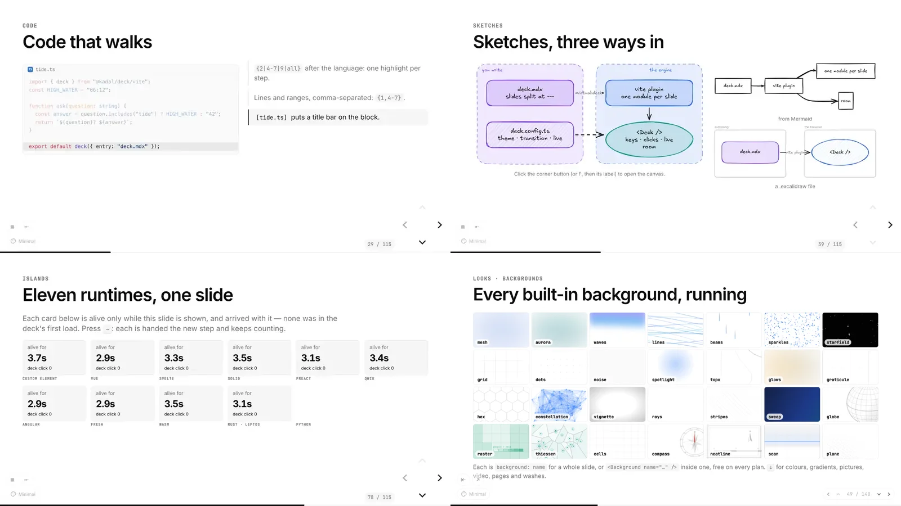
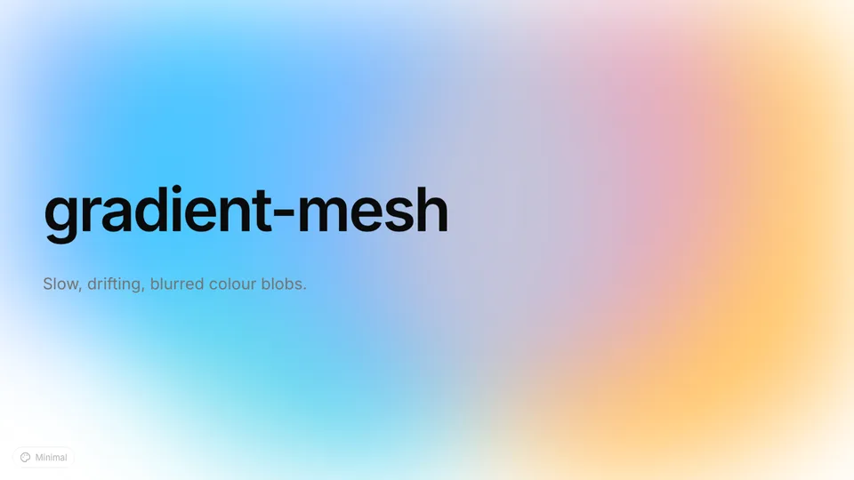
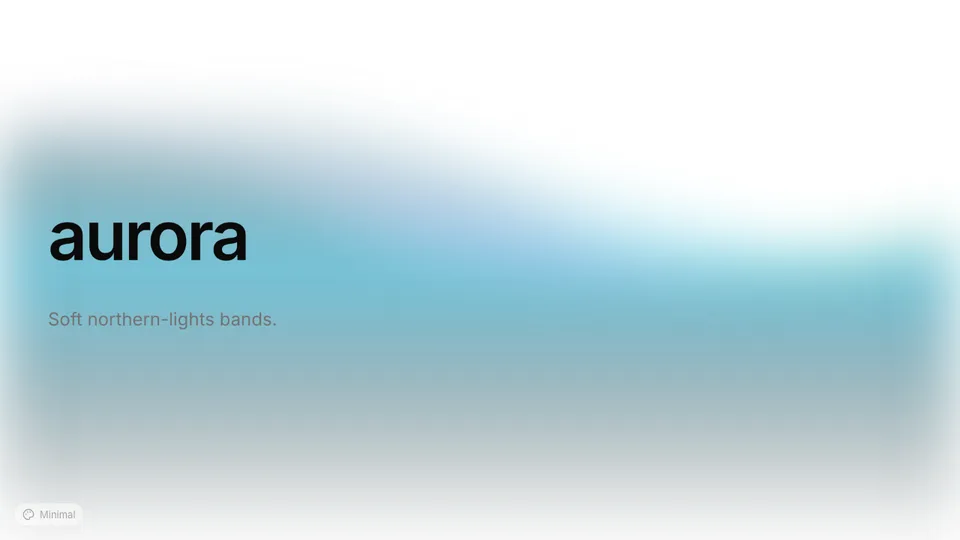
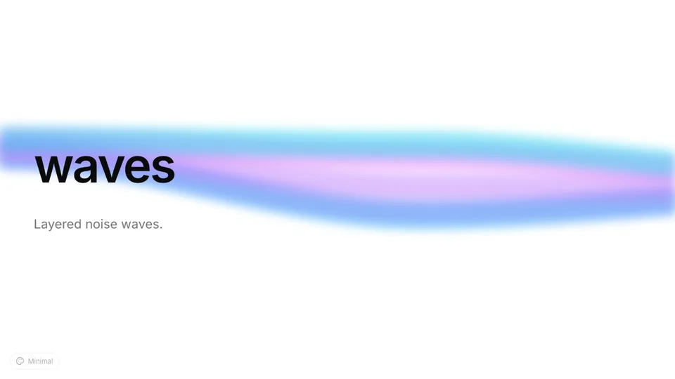
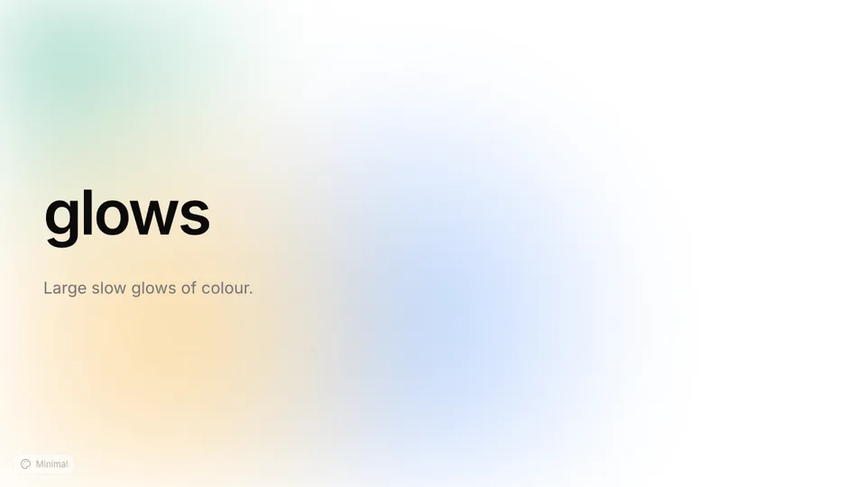
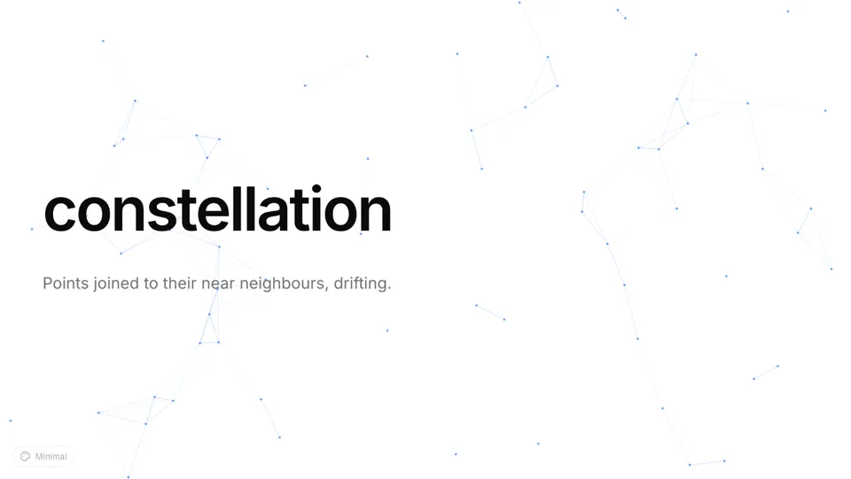
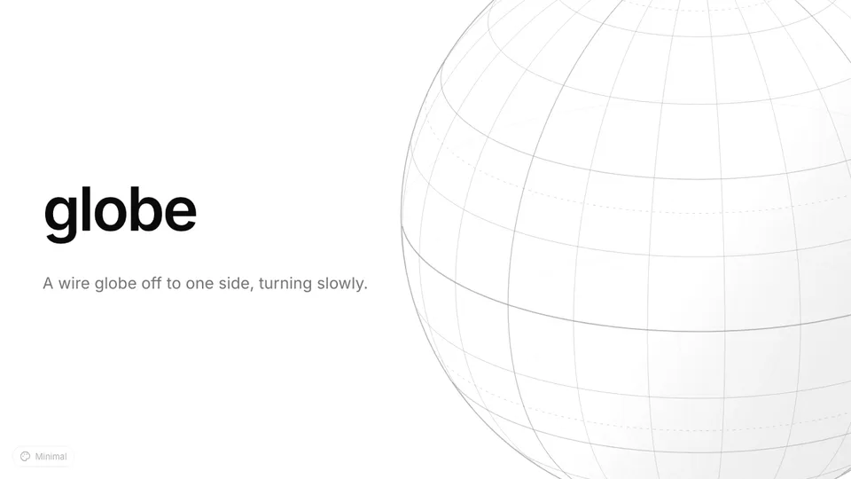

<h1 align="center">Kadal Deck</h1>

<h3 align="center">Build it. Rehearse it. Own the room.</h3>

<p align="center">
  Kadal Deck has your back from the first idea to the last applause: AI that drafts with you,
  rehearsal with a voice and a timeline, a teleprompter and your phone as the clicker, and a live
  room that keeps every seat in it — polls, quizzes, Q&amp;A and reactions.
</p>

<p align="center">
  <a href="https://www.npmjs.com/package/@kadal/deck"></a>
  <a href="https://www.npmjs.com/package/@kadal/deck"></a>
  <a href="https://github.com/kadalcc/deck/actions/workflows/ci.yml"></a>
  <a href="LICENSING.md"></a>
  <a href="https://marketplace.visualstudio.com/items?itemName=kadal.kadal-deck"></a>
  <a href="https://github.com/sponsors/pmithunish"></a>
</p>

A talk is more than its slides. You need an outline that holds, slides that look the part, a few
run-throughs out loud, the right notes in front of you on the day, and a room that stays with you
to the end. Kadal Deck is built for all of it. You write the deck in one `deck.mdx` file, with AI
beside you if you want it; you rehearse it with the deck reading your notes and keeping time; you
present it with your phone in your hand; and the audience joins from theirs to vote, ask and react.
The engine is open source, and hosting is free for public decks.

<p align="center">
  <a href="https://decks.kadal.cc/@kadal-hq/tour/">
    
  </a>
</p>

<p align="center">
  <a href="https://decks.kadal.cc/@kadal-hq/tour/"><strong>Take the tour →</strong></a><br>
  <sub>A deck that shows every feature, built with Kadal Deck. Open it and press <kbd>?</kbd>.</sub>
</p>

<p align="center">
  <a href="https://deck.kadal.cc/docs/getting-started/">Get started</a> ·
  <a href="https://deck.kadal.cc/docs/">Docs</a> ·
  <a href="https://deck.kadal.cc/themes/">Themes</a> ·
  <a href="https://deck.kadal.cc/library/">Pro library</a> ·
  <a href="https://deck.kadal.cc/pricing/">Hosting</a> ·
  <a href="https://deck.kadal.cc/changelog/">Changelog</a>
</p>

---

## Build it

_Start from an idea, not a blank slide._

- ✦ **An AI assistant that drafts with you.** In the [builder on deck.kadal.cc](https://deck.kadal.cc/docs/guides/ai-agent/#the-builder-on-deckkadalcc),
  tell it about the talk ("turn my notes into eight slides", "add a poll after the intro") and it
  writes and revises the deck slide by slide, checks its work against the compiler, and answers
  the comments on your draft. Every change is a revision you can undo. It runs on your own key
  from OpenAI, Anthropic, Google or OpenRouter.
- ✦ **Your own agent, too.** The [Agent Skill and the MCP server](#for-ai-agents) teach Claude
  Code, Cursor, VS Code or any MCP client the format, then let it outline, write slides, lint them,
  render them to look at its own work, and fix what it sees. The hosted MCP server brings your
  published decks to Claude, ChatGPT and Cursor.
- **Write where you like.** Markdown and MDX in your editor, with the [VS Code extension](packages/vscode)
  and the `kadal-deck` CLI, or in the browser builder: edit right on the slide, and drop in emoji,
  icons, stickers, shapes, free photos, GIFs and memes from the media panel.
- **Look the part.** [17 themes](#themes) in light and dark, 28 built-in backgrounds, and the
  [Pro library](#backgrounds-and-layouts) of 95 backgrounds and layouts.

## Rehearse it

_Practise out loud until it's yours._

- **The deck reads your notes aloud** and turns its own pages as it goes, in the browser's voice
  or the Kokoro AI voice running in your browser. [Narration](https://deck.kadal.cc/docs/narration/)
  shows every chapter and slide on a timeline, so you hear how long the talk really runs.
- **A plan for every slide.** Give each slide a time; the timer's bar marks where you should be,
  and a pacing badge says how far ahead or behind you are, so you find the long parts before the day.
- **A teleprompter and the presenter view.** Your notes, big, on the screen you read from, following
  each click; and beside the slide, the notes, the next slide and the timer.
- ✦ **Copilot can quiz you** on your notes while you rehearse a hosted deck.
- **Glossary cards.** The first mention of a term links to its [definition](https://deck.kadal.cc/docs/glossary/),
  so you, and later the room, never lose the thread.

## Present it

_Walk on stage with everything at your fingertips._

<p align="center">
  
  <br>
  <sub>The presenter view: your notes, the next slide, a timer with pacing, the room beside you and every tool on one screen. Press <kbd>S</kbd> in any deck.</sub>
</p>

- **The [presenter view](https://deck.kadal.cc/docs/presenter-and-keyboard/):** notes, timer, next
  slide, drawing, camera and recording, and a share window for video calls.
- **Your phone is the remote.** A live copy of the slide, your notes, the timer, a laser and a pen,
  and an air pointer you aim by moving the phone, paired by a QR code. It works from a static host
  too. [Phone remote](https://deck.kadal.cc/docs/phone-remote/)
- ✦ **Copilot in the presenter view** of a hosted deck. Ask it to go to the results slide, black
  out the screen, circle the total on this slide, or tell you what's in your notes here.
- **Laser, spotlight, pen, zoom, blackout.** A built deck presents offline, and exports to PDF, PNG
  and PPTX.

## Own the room

_Keep every seat with you._

<p align="center">
  
  <br>
  <sub>The audience page, on the same poll as the presenter view above: scan the QR code, no app, no account. The slide stays in step with you, or roams ahead and catches up.</sub>
</p>

- **The audience joins from their phones**, from a link or the QR code on your slide, with no app
  and no sign-in, and follows along. The room runs on deck.kadal.cc or on your own server.
  [The live room](https://deck.kadal.cc/docs/live-room/)
- **Live polls, quizzes, word clouds, Q&A with upvotes, reactions**, a pace check and a raised hand,
  all written as components in your deck.
- **Afterwards, see how it went.** Every hosted deck counts its views; paid plans add the time
  spent on each slide, and Pro and Team keep the sessions and their peak audience, the questions,
  reactions and poll results. [Analytics](https://deck.kadal.cc/docs/publishing/#analytics)

**Open source, on your side.** The engine is AGPL. One `deck.mdx`, in git, published with one command. AI on your own
key: nothing sold, no lock-in. Hosting is [free for public decks](https://deck.kadal.cc/pricing/),
with paid plans from $4 a month.

## Start in 30 seconds

You need Node 20.19 or later.

```sh
npm create @kadal/deck@latest my-talk
cd my-talk && npm install
npm run dev        # http://localhost:5173: edit deck.mdx and the slide you're on updates in place
```

A deck is one `deck.mdx` file: Markdown, split into slides at `---`, with components when you need
them.

```mdx
---
title: Hello, room
theme: ocean
---

# Hello, room

---

## One point at a time

<Clicks>

- Slides split at `---`; a slide below this one starts at `----`
- Code steps line by line, and the notes follow your clicks

</Clicks>

---

<Poll id="lunch" question="Lunch?" options={["Dosa", "Biryani", "Both"]} />
```

When it's ready:

```sh
npx kadal-deck build      # dist/: a static site for any host, works offline
npx kadal-deck export     # PDF in export/ (add --png or --pptx)
npx kadal-deck publish    # a URL on deck.kadal.cc with a live room (free plan)
```

Rather not install anything? Write it in the [builder](https://deck.kadal.cc/app/build) on
deck.kadal.cc. Already have a Slidev or reveal.js deck? `npx kadal-deck import slidev slides.md` or
`npx kadal-deck import reveal index.html` converts it and writes a report of anything that didn't
carry over.

## Everything in the engine

<p align="center">
  
</p>

| | |
| --- | --- |
| **Writing** ([docs](https://deck.kadal.cc/docs/writing-slides/)) | MDX slides, 19 layouts with named slots, frontmatter per slide, `src:` includes, glossary terms the compiler links on first mention |
| **Clicks and motion** ([docs](https://deck.kadal.cc/docs/clicks-and-animation/)) | `<Click>`, `<Clicks>`, `at="+2"`, notes that follow your clicks, 7 transitions (a different one in and out if you like), auto-animate, `<Motion>` |
| **Code** ([docs](https://deck.kadal.cc/docs/code/)) | Shiki highlighting stepped line by line, magic move, Monaco editors, runnable JS/TS/Python, TwoSlash hovers, code groups, snippet imports |
| **Maths, diagrams, sketches** ([docs](https://deck.kadal.cc/docs/math-diagrams-sketches/)) | KaTeX at build time, Mermaid in the deck's colours, Excalidraw drawings revealed region by region |
| **Looks** ([docs](https://deck.kadal.cc/docs/themes-and-backgrounds/)) | 17 themes in light and dark, 28 built-in backgrounds (most of them animated), the [Pro library](#backgrounds-and-layouts) of 95 backgrounds and layouts on deck.kadal.cc, 200,000 icons through Iconify, Tailwind |
| **Any framework** ([docs](https://deck.kadal.cc/docs/islands/)) | React and web components built in; Vue, Svelte, Solid, Preact, Qwik, Angular, Fresh, Rust/WebAssembly and Python as islands, each loaded only when its slide appears |
| **Rehearsing** ([docs](https://deck.kadal.cc/docs/narration/)) | Narration that reads the notes and turns the pages, per-slide timings with a pacing badge, a teleprompter window, glossary cards |
| **Presenting** ([docs](https://deck.kadal.cc/docs/presenter-and-keyboard/)) | Presenter view with notes, timer and next slide; drawing, laser, spotlight, blackout, camera, recording; a share window for video calls; a phone remote; vim keys |
| **The live room** ([docs](https://deck.kadal.cc/docs/live-room/)) | The audience follows on their phones: reactions, questions with upvotes, polls, word clouds, timed quizzes, a pace dial and a raised hand |
| **Export** ([docs](https://deck.kadal.cc/docs/export/)) | PDF, PNG and PPTX, with or without each click step; a static build that works offline |

## Backgrounds and layouts

**The Pro library.** 95 backgrounds and layouts in 15 genres — board-pack covers, KPI boards,
magazine spreads, terminal covers, lecture outlines, synthwave grids, wedding invitations — each in
light and dark, each wearing your deck's theme. One line of frontmatter picks one:

```yaml
---
layout: pro/kpi-board
background: pro/neon-drift
---
```

<table>
<tr>
<td align="center" width="25%"><a href="https://deck.kadal.cc/library/"><picture><source media="(prefers-color-scheme: dark)" srcset="https://deck.kadal.cc/api/v1/library/previews/exec-cover/card-dark.webp"></picture></a><br><code>layout: pro/exec-cover</code></td>
<td align="center" width="25%"><a href="https://deck.kadal.cc/library/"><picture><source media="(prefers-color-scheme: dark)" srcset="https://deck.kadal.cc/api/v1/library/previews/kpi-board/card-dark.webp"></picture></a><br><code>layout: pro/kpi-board</code></td>
<td align="center" width="25%"><a href="https://deck.kadal.cc/library/"><picture><source media="(prefers-color-scheme: dark)" srcset="https://deck.kadal.cc/api/v1/library/previews/pull-quote/card-dark.webp"></picture></a><br><code>layout: pro/pull-quote</code></td>
<td align="center" width="25%"><a href="https://deck.kadal.cc/library/"><picture><source media="(prefers-color-scheme: dark)" srcset="https://deck.kadal.cc/api/v1/library/previews/terminal-cover/card-dark.webp"></picture></a><br><code>layout: pro/terminal-cover</code></td>
</tr>
<tr>
<td align="center" width="25%"><a href="https://deck.kadal.cc/library/"><picture><source media="(prefers-color-scheme: dark)" srcset="https://deck.kadal.cc/api/v1/library/previews/neon-drift/card-dark.webp"></picture></a><br><code>background: pro/neon-drift</code></td>
<td align="center" width="25%"><a href="https://deck.kadal.cc/library/"><picture><source media="(prefers-color-scheme: dark)" srcset="https://deck.kadal.cc/api/v1/library/previews/ridges/card-dark.webp"></picture></a><br><code>background: pro/ridges</code></td>
<td align="center" width="25%"><a href="https://deck.kadal.cc/library/"><picture><source media="(prefers-color-scheme: dark)" srcset="https://deck.kadal.cc/api/v1/library/previews/riso-shapes/card-dark.webp"></picture></a><br><code>background: pro/riso-shapes</code></td>
<td align="center" width="25%"><a href="https://deck.kadal.cc/library/"><picture><source media="(prefers-color-scheme: dark)" srcset="https://deck.kadal.cc/api/v1/library/previews/breathe/card-dark.webp"></picture></a><br><code>background: pro/breathe</code></td>
</tr>
</table>

The library renders on decks published to [deck.kadal.cc](https://deck.kadal.cc/pricing/) from a
**Pro or Team** workspace. Anywhere else — a static build on your own host, or the free plan — a
`pro/` name falls back to the theme's own background and the default layout, so the slide still
reads; only the dev server says why, in a small chip. Every item, moving, in light and dark:
[deck.kadal.cc/library](https://deck.kadal.cc/library/).

**Built in, free everywhere.** 28 backgrounds ship with the engine — `background: aurora`, or
`<Background name="aurora" />` inside a slide — most of them animated, all paused off-slide and
still under reduced motion. A few of them:

<table>
<tr>
<td align="center" width="33%"><picture><source media="(prefers-color-scheme: dark)" srcset=".github/assets/backgrounds/gradient-mesh-dark.webp"></picture><br><code>background: gradient-mesh</code></td>
<td align="center" width="33%"><picture><source media="(prefers-color-scheme: dark)" srcset=".github/assets/backgrounds/aurora-dark.webp"></picture><br><code>background: aurora</code></td>
<td align="center" width="33%"><picture><source media="(prefers-color-scheme: dark)" srcset=".github/assets/backgrounds/waves-dark.webp"></picture><br><code>background: waves</code></td>
</tr>
<tr>
<td align="center" width="33%"><picture><source media="(prefers-color-scheme: dark)" srcset=".github/assets/backgrounds/glows-dark.webp"></picture><br><code>background: glows</code></td>
<td align="center" width="33%"><picture><source media="(prefers-color-scheme: dark)" srcset=".github/assets/backgrounds/constellation-dark.webp"></picture><br><code>background: constellation</code></td>
<td align="center" width="33%"><picture><source media="(prefers-color-scheme: dark)" srcset=".github/assets/backgrounds/globe-dark.webp"></picture><br><code>background: globe</code></td>
</tr>
</table>

## Themes

Sixteen themes, each in light and dark where it makes sense. Three are built in; the rest are
packages you install and name in the headmatter (`theme: ocean`). Browse them all at
[deck.kadal.cc/themes](https://deck.kadal.cc/themes/).

<table>
<tr>
<td align="center" width="25%"><br><b>minimal</b> · built in</td>
<td align="center" width="25%"><br><b>rla</b> · built in</td>
<td align="center" width="25%"><br><b>stack</b> · built in</td>
<td align="center" width="25%"><a href="packages/theme-ocean"><br><b>ocean</b></a></td>
</tr>
<tr>
<td align="center"><a href="packages/theme-brand"><br><b>brand</b></a></td>
<td align="center"><a href="packages/theme-crayon"><br><b>crayon</b></a></td>
<td align="center"><a href="packages/theme-folio"><br><b>folio</b></a></td>
<td align="center"><a href="packages/theme-lecture"><br><b>lecture</b></a></td>
</tr>
<tr>
<td align="center"><a href="packages/theme-neon"><br><b>neon</b></a></td>
<td align="center"><a href="packages/theme-swiss"><br><b>swiss</b></a></td>
<td align="center"><a href="packages/theme-terminal"><br><b>terminal</b></a></td>
<td align="center"><a href="packages/theme-classic"><br><b>classic</b></a></td>
</tr>
<tr>
<td align="center"><a href="packages/theme-seriph"><br><b>seriph</b></a></td>
<td align="center"><a href="packages/theme-crisp"><br><b>crisp</b></a></td>
<td align="center"><a href="packages/theme-bricks"><br><b>bricks</b></a></td>
<td align="center"><a href="packages/theme-shibainu"><br><b>shibainu</b></a></td>
</tr>
</table>

Classic, seriph, crisp, bricks and shibainu are ports of the official Slidev themes, MIT-licensed,
with credit to their authors in each package. `npm create @kadal/deck@latest -- --theme <name>`
starts a theme of your own; the contract is [THEMES.md](packages/deck/THEMES.md).

## For AI agents

Kadal Deck is built to be written by an agent as well as by you: a skill that teaches the format,
an MCP server that edits slides line by line and renders them so the agent can look at its work,
and a CLI whose every command answers in JSON. Guide: [AI agents](https://deck.kadal.cc/docs/ai-agents/).

```text
/plugin marketplace add kadalcc/deck          # Claude Code: the skill and the MCP server together
/plugin install kadal-deck@kadal-deck
```

```sh
npx skills add kadalcc/deck                              # the skill alone, for any agent (skills/kadal-deck)
claude mcp add kadal-deck -- npx -y @kadal/deck mcp      # the MCP server alone
```

For Claude Desktop, Cursor and VS Code, point the client at `npx -y @kadal/deck mcp`. The server
works in the folder it starts in (or `--dir <path>`) and never reads or writes outside it unless
started with `--allow-outside`.

| MCP tools | |
| --- | --- |
| `deck_reference`, `deck_frontmatter_schema` | every component, layout, background and option, from the engine's own catalog |
| `deck_create`, `deck_outline`, `deck_read_slide`, `deck_check` | scaffold, read the deck as structure, lint it |
| `slide_add`, `slide_update`, `slide_remove`, `slide_move`, `deck_update_frontmatter`, `notes_set` | edits that change only that slide's lines, linted on the spot |
| `slide_render`, `deck_preview` | PNGs of slides from a dev server kept running between calls, and a live URL |
| `deck_build`, `deck_export`, `deck_publish` | a static site, PDF/PNG/PPTX, and a published deck |
| `media_search`, `media_trending`, `media_used` | icons, emoji, stickers, GIFs, memes, meme templates and Kadal's own library, each with the MDX to insert and its credit (`credits: true` lists them all on a Credits slide) |

**Hosted decks, from any agent.** The hosted service runs a remote MCP server at
`https://deck.kadal.cc/mcp` (OAuth; you pick one workspace and can make the connection read-only).
It lists and inspects your published decks, reads a talk in progress (current slide, polls,
questions by votes), changes titles, visibility and passcodes, rolls back versions, makes share
links, and quick-edits and publishes decks through the web builder without ever overwriting newer
work. Add it as a custom connector in Claude, ChatGPT or Cursor, or with
`claude mcp add --transport http kadal-deck-hosted https://deck.kadal.cc/mcp`.

[](https://glama.ai/mcp/connectors/cc.kadal/deck)

For scripts: `kadal-deck check` (exit 1 on errors), `kadal-deck screenshot`, `kadal-deck info [topic]`,
and `--json` on every command. Exit codes: 0 ok, 1 failed, 2 usage, 3 not signed in, 4 missing
prerequisite. `@kadal/deck/catalog` is everything a deck can use as data, `@kadal/deck/authoring`
reads, lints and edits a deck as text, and `@kadal/deck/schema/frontmatter.json` is the JSON Schema
for frontmatter.

## In your editor

- **[VS Code extension](packages/vscode)** ([Marketplace](https://marketplace.visualstudio.com/items?itemName=kadal.kadal-deck)):
  a live preview that follows your cursor, a slide outline you drag to reorder, IntelliSense for
  every setting and component, the deck's checks as problems, and formatting.
- **[`@kadal/prettier-plugin`](packages/prettier-plugin)**: Prettier for deck files, in any editor
  that runs Prettier. `kadal-deck format` runs the same formatter with no setup.
- **In the browser**: press <kbd>E</kbd> in `kadal-deck dev` for a side editor on the slide you're on.

## How it works

<p align="center">
  
</p>

Each slide is its own module, so an edit re-renders one slide, not the deck. The drawing is an
[Excalidraw file](.github/assets/how-it-works.excalidraw), drawn with the same sketch DSL a slide's
`<Sketch>` uses.

## Hosted or self-hosted

Writing, presenting, the presenter view, export and a static build need nothing but this engine,
and stay free. The **live room** needs a server holding a WebSocket per deck.

- **[deck.kadal.cc](https://deck.kadal.cc)**: `npx kadal-deck publish` gives the deck a URL, a live
  room, analytics, passcodes, version history and teams, and quick edit on the web that
  `kadal-deck pull` merges back into your files slide by slide. There is a [free plan](https://deck.kadal.cc/pricing/),
  and the paid plans fund the engine.
- **Your own host**: `kadal-deck build` output runs on any static host (`kadal-deck ci` writes the
  deploy files for GitHub Pages, Netlify, Vercel, Cloudflare or Docker). The room protocol is typed
  in `@kadal/deck/protocol` and [documented endpoint by endpoint](https://deck.kadal.cc/docs/self-hosting/),
  and `kadal-deck relay` gives a static build the phone remote.

## Packages

| Package | Version | |
| --- | --- | --- |
| [`@kadal/deck`](packages/deck) | [](https://www.npmjs.com/package/@kadal/deck) | The engine: MDX compiler and Vite plugin, runtime, components, themes, live client, export, the `kadal-deck` CLI and MCP server |
| [`@kadal/create-deck`](packages/create-deck) | [](https://www.npmjs.com/package/@kadal/create-deck) | `npm create @kadal/deck@latest`: a new deck, theme or addon |
| [`@kadal/deck-vue`](packages/deck-vue), [`-svelte`](packages/deck-svelte), [`-solid`](packages/deck-solid), [`-preact`](packages/deck-preact), [`-qwik`](packages/deck-qwik), [`-angular`](packages/deck-angular), [`-fresh`](packages/deck-fresh), [`-wasm`](packages/deck-wasm), [`-python`](packages/deck-python) | [](https://www.npmjs.com/org/kadal) | Framework renderers for islands |
| `@kadal/theme-*` (13 packages) | [](https://www.npmjs.com/org/kadal) | The themes above |
| [`@kadal/prettier-plugin`](packages/prettier-plugin) | [](https://www.npmjs.com/package/@kadal/prettier-plugin) | Prettier for deck files |
| [Kadal Deck for VS Code](packages/vscode) | [](https://marketplace.visualstudio.com/items?itemName=kadal.kadal-deck) | Preview, outline, IntelliSense, checks and formatting |
| [`@kadal/deck-shell`](packages/deck-shell) | not on npm yet | A prebuilt page that runs any `deck.mdx` compiled in the browser, for hosts and editors |

All `@kadal/*` packages version together and are published from this repository's
[release workflow](.github/workflows/release.yml) through npm trusted publishing, with
[provenance](https://docs.npmjs.com/generating-provenance-statements) on each npm page. The VS Code
extension is published by its [own workflow](.github/workflows/vscode.yml).

## Documentation

[Getting started](https://deck.kadal.cc/docs/getting-started/) ·
[Writing slides](https://deck.kadal.cc/docs/writing-slides/) ·
[Components](https://deck.kadal.cc/docs/components/) ·
[Configuration](https://deck.kadal.cc/docs/configuration/) ·
[CLI](https://deck.kadal.cc/docs/cli/) ·
[Publishing](https://deck.kadal.cc/docs/publishing/) ·
[Writing a theme](https://deck.kadal.cc/docs/writing-a-theme/) ·
[Coming from Slidev](https://deck.kadal.cc/docs/coming-from-slidev/)

The engine's full reference, with every component and option, is in
[`packages/deck/README.md`](packages/deck/README.md), and `npx kadal-deck info` prints it in the
terminal.

## Licence

**[AGPL-3.0-or-later](LICENSE)**. Presenting with Kadal Deck, self-hosting your own decks, and
embedding a deck in a site you publish trigger nothing; you owe nobody anything. If you run a
**modified** engine as a network service, its users must be able to get your modified source.

Building a hosted or proprietary product on the engine without publishing your changes? A
commercial licence removes the AGPL obligations: write to **hello@kadal.cc**. Details are in
[LICENSING.md](LICENSING.md). The five ported themes are MIT, and third-party notices are in
[THIRD_PARTY_NOTICES.md](THIRD_PARTY_NOTICES.md).

## Contributing

A bug report with a small `deck.mdx` that reproduces it is the most useful thing you can send, and
pull requests are welcome. [CONTRIBUTING.md](CONTRIBUTING.md) covers the setup (Bun 1.3+), the
tests and the island verifier. Questions and ideas go to
[Discussions](https://github.com/kadalcc/deck/discussions). Please follow the
[code of conduct](CODE_OF_CONDUCT.md), and report security issues privately as
[SECURITY.md](SECURITY.md) describes.

## Sponsors

Sponsorships pay for time on the open-source engine: issues, docs, new islands and the features
you ask for. **[Sponsor Kadal Deck on GitHub](https://github.com/sponsors/pmithunish)**; the tiers
and what each one gets are on [deck.kadal.cc/sponsor](https://deck.kadal.cc/sponsor/), and backers
are listed in [BACKERS.md](BACKERS.md). Companies can sponsor
[by invoice](https://docs.github.com/en/sponsors/sponsoring-open-source-contributors/paying-for-github-sponsors-by-invoice).

<!-- sponsors: Gold, Silver and Bronze logos and Patron avatars go here, largest first -->
<p align="center">
  <a href="https://github.com/sponsors/pmithunish"><strong>Your logo here</strong></a>:
  be the first company to sponsor Kadal Deck.
</p>
<!-- /sponsors -->

<p align="center">
  <sub>Made in Chennai by <a href="https://kadal.cc">Kadal</a> · <a href="https://deck.kadal.cc">deck.kadal.cc</a> · <a href="mailto:hello@kadal.cc">hello@kadal.cc</a></sub>
</p>
