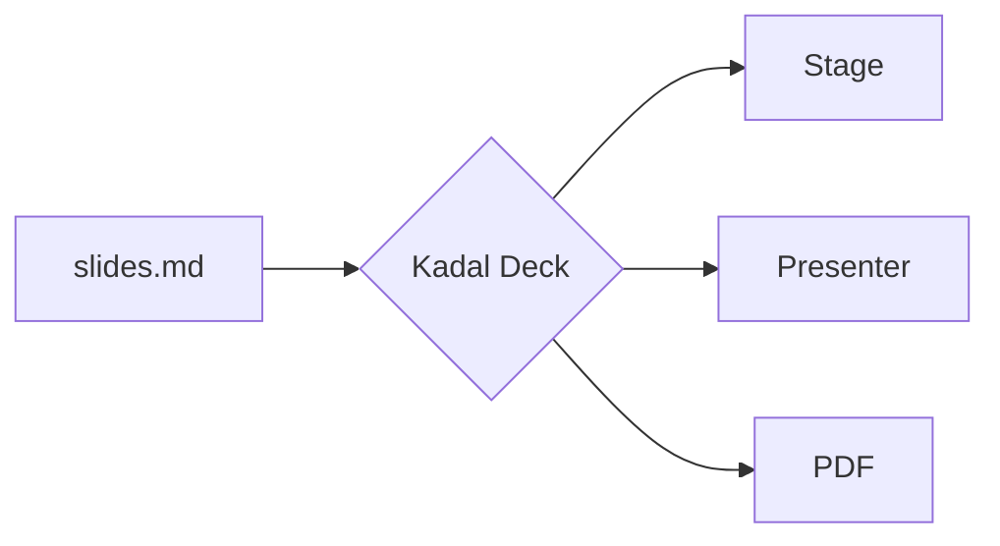
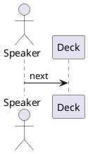

<p className="sc-eyebrow">Chapter 10</p>

# Slidev syntax, natively

Comment notes, block frontmatter, scoped styles, diagram fences, stepped maths: a Slidev deck's Markdown, read as it is.

<!-- A comment in the middle of a slide is not notes: it is dropped, since MDX cannot take one. -->

<p className="sc-small">This slide's notes are an HTML comment at its end. Press <Kbd>S</Kbd> to read them in the presenter view.</p>

<!--
Chapter ten. These notes are written the Slidev way: an HTML comment at the very end of the slide. The comment in the middle of the slide is not notes; it is dropped, because MDX could not compile it.

Notes in a `<Notes>` block and notes in comments can sit on the same slide; they join, in order.
-->

----

```yaml
id: slidev-frontmatter
class: sc-slidev-block
```

<p className="sc-eyebrow">Slidev syntax · block frontmatter and scoped style</p>

## Settings in a YAML fence, CSS for one slide

<Cols cols="1fr 1fr" gap="2.5rem" align="start">
<Col>

A ```` ```yaml ```` fence as the very first thing in a slide is its frontmatter: editors highlight it and formatters format it.

A `<style>` block styles its own slide and no other. This heading's green and underline, and the ring around the code, are this slide's CSS; the next slide's heading is untouched.

<p className="sc-small">`<style global>` is for CSS meant for the whole deck.</p>

</Col>
<Col>

<How>

````md
```yaml
id: slidev-frontmatter
class: sc-slidev-block
```

## Settings in a YAML fence

<style>
h2 { color: #047857; text-decoration: underline #10b981; }
html.dark h2 { color: #6ee7b7; }
.sc-how { outline: 3px solid #10b981; }
</style>
````

</How>

</Col>
</Cols>

<style>
h2 {
  color: #047857;
  text-decoration: underline 0.12em #10b981;
  text-underline-offset: 0.22em;
}
html.dark h2 {
  color: #6ee7b7;
}
.sc-how {
  outline: 3px solid #10b981;
  outline-offset: 6px;
  border-radius: 10px;
}
</style>

<!--
Two Slidev spellings on one slide. The YAML fence at the top is this slide's frontmatter — its id and its class — exactly as if it sat between two lines of dashes.

The style block is scoped: the compiler prefixes every selector with this slide, so the green heading and the ring stay here — and `html.dark` in front still means the dark scheme. Move on and the next heading is plain.
-->

----
id: slidev-mermaid
---

<p className="sc-eyebrow">Slidev syntax · diagram fences</p>

## ```` ```mermaid ```` fences

<Cols cols="1.2fr 1fr" gap="2.5rem" align="center">
<Col>



</Col>
<Col>

<How>

````md
```mermaid {scale: 1.4, look: 'handDrawn'}
flowchart LR
  A[slides.md] --> B{Kadal Deck}
  …
```
````

</How>

<p className="sc-small">Options are Slidev's: `scale`, `theme`, and any Mermaid setting. The deck's `mermaid:` headmatter sets them for every diagram.</p>

</Col>
</Cols>

<!--
A mermaid fence renders through the same Mermaid component as before, in the deck's colours. The braces after the language are Slidev's options: scale, a theme, or any of Mermaid's own settings — here the hand-drawn look.
-->

----
id: slidev-plantuml
---

<p className="sc-eyebrow">Slidev syntax · diagram fences</p>

## ```` ```plantuml ```` fences

<Cols cols="1.2fr 1fr" gap="2.5rem" align="center">
<Col>

```plantuml {alt: 'The speaker moves, the deck follows, the audience reacts'}
@startuml
actor Speaker
participant Deck
actor Audience
Speaker -> Deck : next
Deck -> Audience : slide and clicks
Audience --> Speaker : reactions
@enduml
```

</Col>
<Col>

<How>

````md

````

</How>

<p className="sc-small">An SVG from a PlantUML server, the source encoded into its address. `plantUmlServer:` in the headmatter points at your own.</p>

</Col>
</Cols>

<!--
PlantUML diagrams are drawn by a PlantUML server: the source is compressed and encoded into the image address, the standard way, so the hosted builder makes the same address as a local build. Set plantUmlServer in the headmatter to use a server of your own.
-->

----
id: slidev-maths-lines
---

<p className="sc-eyebrow">Slidev syntax · maths lines</p>

## Maths that walks: `$$ {1|2|3|all}`

<Cols cols="1.25fr 1fr" gap="2.5rem" align="center">
<Col>

$$ {1|2|3|4|all}
\begin{aligned}
\nabla \cdot \vec{E} &= \frac{\rho}{\varepsilon_0} \\
\nabla \cdot \vec{B} &= 0 \\
\nabla \times \vec{E} &= -\frac{\partial\vec{B}}{\partial t} \\
\nabla \times \vec{B} &= \mu_0\vec{J} + \mu_0\varepsilon_0\frac{\partial\vec{E}}{\partial t}
\end{aligned}
$$

</Col>
<Col>

<How>

```md
$$ {1|2|3|4|all}
\begin{aligned}
\nabla \cdot \vec{E} &= \frac{\rho}{\varepsilon_0} \\
…
\end{aligned}
$$
```

</How>

<p className="sc-small">Steps after the `$$`, as on a code fence: each one is a click. `{at: 2}` and `{finally: 'all'}` work too.</p>

</Col>
</Cols>

<!--
Maxwell's equations, one at a time. The braces after the double dollar list the lines to light, one step per click, just like a code block's highlights. Gauss's law first.
[click] No magnetic monopoles.
[click] Faraday's law of induction.
[click] Ampère's law, with Maxwell's correction.
[click] And all four together.
-->

----
id: slidev-transition
transition: flip
---

<p className="sc-eyebrow">Slidev syntax · custom transitions</p>

## `transition: flip`

<Cols cols="1fr 1fr" gap="2.5rem" align="start">
<Col>

A transition is two CSS animations, one for the slide arriving and one for the slide leaving. Define the keyframes, hook them to a name, and any slide can use it. This slide flipped in.

<p className="sc-small">Or name the keyframes in the headmatter: `transitions: { flip: { in: flip-in, out: flip-out } }`, or call `registerTransition` from a theme.</p>

</Col>
<Col>

<How>

```css
@keyframes flip-in {
  from { transform: rotateY(-90deg); opacity: 0; }
}
.deck-stage[data-transition="flip"] {
  --deck-anim-in: flip-in;
}
.deck-stage[data-transition-out="flip"] {
  --deck-anim-out: flip-out;
}
```

</How>

</Col>
</Cols>

<style global>
@keyframes sc-flip-in {
  from {
    transform: rotateY(-90deg) scale(0.9);
    opacity: 0;
  }
}
@keyframes sc-flip-out {
  to {
    transform: rotateY(90deg) scale(0.9);
    opacity: 0;
  }
}
@keyframes sc-flip-in-back {
  from {
    transform: rotateY(90deg) scale(0.9);
    opacity: 0;
  }
}
@keyframes sc-flip-out-back {
  to {
    transform: rotateY(-90deg) scale(0.9);
    opacity: 0;
  }
}
.deck-stage[data-transition="flip"] {
  --deck-anim-in: sc-flip-in;
}
.deck-stage[data-transition-out="flip"] {
  --deck-anim-out: sc-flip-out;
}
.deck-stage[data-transition="flip"][data-direction="back"] {
  --deck-anim-in: sc-flip-in-back;
}
.deck-stage[data-transition-out="flip"][data-direction="back"] {
  --deck-anim-out: sc-flip-out-back;
}
</style>

<!--
This slide arrived with a transition the engine does not ship: flip. The keyframes and the two hooks are a global style block on this slide; the stage writes the transition's name and the direction on itself, and the stylesheet does the rest. Speeds, reduced motion and print all behave as they do for the built-in transitions.
-->

----
id: slidev-build
---

<p className="sc-eyebrow">Slidev's build · and a little more</p>

## One build, any host, no network

<Cols cols="1fr 1.1fr" gap="2.5rem" align="start">
<Col>

<How>

```yaml
seoMeta:
  ogImage: auto        # slide 1 → og-image.png
  ogUrl: https://you.dev/talk/
pwa: true              # installable, presents offline
bundleRemoteAssets: true
```

```sh
kadal-deck build --base /talk/
kadal-deck build a.mdx b.mdx   # dist/a/, dist/b/
kadal-deck ci github-pages
kadal-deck serve
```

</How>

</Col>
<Col>

- The headmatter becomes the page's head: title, description, Open Graph and Twitter cards, canonical, `lang`
- `ogImage: auto` photographs this deck's first slide at 1200×630
- `pwa`: a manifest, icons in the theme's colours, and a service worker that never touches the live room
- Remote pictures, video and Google Fonts copied into the build
- Every route (`/presenter`, `/notes`…) works on GitHub Pages, S3 or nginx, with no rewrites

</Col>
</Cols>

<!--
What Slidev's build does, and a little more. The headmatter writes the page's head, so a link to the deck shows its title, its description and a picture of its first slide, taken at build time. With pwa on, the deck installs like an app and presents with no network at all; with bundleRemoteAssets, the pictures and fonts it borrows from the web come along in the build. Several decks build in one command, under any base path, and kadal-deck ci writes the files a host needs: GitHub Pages, Netlify, Vercel, Cloudflare, or a Docker image.
-->
