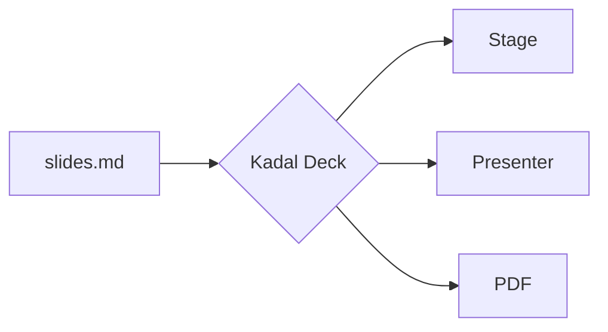
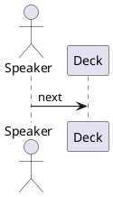

<p className="sc-eyebrow">Chapter 10</p>

# Markdown syntax you already know

Comment notes, block frontmatter, scoped styles, diagram fences, stepped maths: a Slidev deck's Markdown, read as it is, and a command that converts a whole Slidev project.

<!-- A comment in the middle of a slide is not notes: it is dropped, since MDX cannot take one. -->

<p className="sc-small">This slide's notes are an HTML comment at its end. Press <Kbd>S</Kbd> to read them in the presenter view.</p>

<!--
Chapter ten. These notes are written the Slidev way: an HTML comment at the very end of the slide. The comment in the middle of the slide is not notes; it is dropped, because MDX could not compile it.

Notes in a `<Notes>` block and notes in comments can sit on the same slide; they join, in order.
-->

----
id: slidev-import
---

<p className="sc-eyebrow">Slidev syntax · bringing a deck over</p>

## One command for a whole Slidev project

<Cols cols="1fr 1fr" gap="2.5rem" align="start">
<Col>

<How>

```sh
npx kadal-deck import slidev ./slides.md
# → slides-kadal/  deck.mdx, components as TSX,
#   styles, public/, and IMPORT-REPORT.md
cd slides-kadal && npx kadal-deck dev
```

</How>

</Col>
<Col>

- The headmatter, the theme (to its Kadal port), transitions, fonts and export options
- Every click directive and its component form, Vue's template syntax, UnoCSS classes
- The project's Vue components, layouts and global layers, as TSX
- `IMPORT-REPORT.md`: what did not carry over, slide by slide

</Col>
</Cols>

<!--
The importer writes a new deck folder and changes nothing in the Slidev project; it runs nothing in it either. Slidev's own starter deck converts with sixteen of its seventeen slides needing nothing further. The rest of this chapter is what needs no converting at all: Slidev's Markdown, read as it is.
-->

----

```yaml
id: slidev-frontmatter
class: sc-slidev-block
```

<p className="sc-eyebrow">Slidev syntax · block frontmatter and scoped style</p>

## Settings in a YAML fence, CSS for one slide

<Cols cols="1fr 1fr" gap="2.5rem" align="start">
<Col>

A ```` ```yaml ```` fence as the very first thing in a slide is its frontmatter: editors highlight it and formatters format it.

A `<style>` block styles its own slide and no other. This heading's green and underline, and the ring around the code, are this slide's CSS; the next slide's heading is untouched.

<p className="sc-small">`<style global>` is for CSS meant for the whole deck.</p>

</Col>
<Col>

<How>

````md
```yaml
id: slidev-frontmatter
class: sc-slidev-block
```

## Settings in a YAML fence

<style>
h2 { color: #047857; text-decoration: underline #10b981; }
html.dark h2 { color: #6ee7b7; }
.sc-how { outline: 3px solid #10b981; }
</style>
````

</How>

</Col>
</Cols>

<style>
h2 {
  color: #047857;
  text-decoration: underline 0.12em #10b981;
  text-underline-offset: 0.22em;
}
html.dark h2 {
  color: #6ee7b7;
}
.sc-how {
  outline: 3px solid #10b981;
  outline-offset: 6px;
  border-radius: 10px;
}
</style>

<!--
Two Slidev spellings on one slide. The YAML fence at the top is this slide's frontmatter — its id and its class — exactly as if it sat between two lines of dashes.

The style block is scoped: the compiler prefixes every selector with this slide, so the green heading and the ring stay here — and `html.dark` in front still means the dark scheme. Move on and the next heading is plain.
-->

----
id: slidev-mermaid
---

<p className="sc-eyebrow">Slidev syntax · diagram fences</p>

## ```` ```mermaid ```` fences

<Cols cols="1.2fr 1fr" gap="2.5rem" align="center">
<Col>



</Col>
<Col>

<How>

````md
```mermaid {scale: 1.4, look: 'handDrawn'}
flowchart LR
  A[slides.md] --> B{Kadal Deck}
  …
```
````

</How>

<p className="sc-small">Options are Slidev's: `scale`, `theme`, and any Mermaid setting. The deck's `mermaid:` headmatter sets them for every diagram.</p>

</Col>
</Cols>

<!--
A mermaid fence renders through the same Mermaid component as before, in the deck's colours. The braces after the language are Slidev's options: scale, a theme, or any of Mermaid's own settings — here the hand-drawn look.
-->

----
id: slidev-plantuml
---

<p className="sc-eyebrow">Slidev syntax · diagram fences</p>

## ```` ```plantuml ```` fences

<Cols cols="1.2fr 1fr" gap="2.5rem" align="center">
<Col>

```plantuml {alt: 'The speaker moves, the deck follows, the audience reacts'}
@startuml
actor Speaker
participant Deck
actor Audience
Speaker -> Deck : next
Deck -> Audience : slide and clicks
Audience --> Speaker : reactions
@enduml
```

</Col>
<Col>

<How>

````md

````

</How>

<p className="sc-small">An SVG from a PlantUML server, the source encoded into its address. `plantUmlServer:` in the headmatter points at your own.</p>

</Col>
</Cols>

<!--
PlantUML diagrams are drawn by a PlantUML server: the source is compressed and encoded into the image address, the standard way, so the hosted builder makes the same address as a local build. Set plantUmlServer in the headmatter to use a server of your own.
-->

----
id: slidev-maths-lines
---

<p className="sc-eyebrow">Slidev syntax · maths lines</p>

## Maths that walks: `$$ {1|2|3|all}`

<Cols cols="1.25fr 1fr" gap="2.5rem" align="center">
<Col>

$$ {1|2|3|4|all}
\begin{aligned}
\nabla \cdot \vec{E} &= \frac{\rho}{\varepsilon_0} \\
\nabla \cdot \vec{B} &= 0 \\
\nabla \times \vec{E} &= -\frac{\partial\vec{B}}{\partial t} \\
\nabla \times \vec{B} &= \mu_0\vec{J} + \mu_0\varepsilon_0\frac{\partial\vec{E}}{\partial t}
\end{aligned}
$$

</Col>
<Col>

<How>

```md
$$ {1|2|3|4|all}
\begin{aligned}
\nabla \cdot \vec{E} &= \frac{\rho}{\varepsilon_0} \\
…
\end{aligned}
$$
```

</How>

<p className="sc-small">Steps after the `$$`, as on a code fence: each one is a click. `{at: 2}` and `{finally: 'all'}` work too.</p>

</Col>
</Cols>

<!--
Maxwell's equations, one at a time. The braces after the double dollar list the lines to light, one step per click, just like a code block's highlights. Gauss's law first.
[click] No magnetic monopoles.
[click] Faraday's law of induction.
[click] Ampère's law, with Maxwell's correction.
[click] And all four together.
-->

----
id: slidev-transition
transition: flip
---

<p className="sc-eyebrow">Slidev syntax · custom transitions</p>

## `transition: flip`

<Cols cols="1fr 1fr" gap="2.5rem" align="start">
<Col>

A transition is two CSS animations, one for the slide arriving and one for the slide leaving. Define the keyframes, hook them to a name, and any slide can use it. This slide flipped in.

<p className="sc-small">Or name the keyframes in the headmatter: `transitions: { flip: { in: flip-in, out: flip-out } }`, or call `registerTransition` from a theme.</p>

</Col>
<Col>

<How>

```css
@keyframes flip-in {
  from { transform: rotateY(-90deg); opacity: 0; }
}
.deck-stage[data-transition="flip"] {
  --deck-anim-in: flip-in;
}
.deck-stage[data-transition-out="flip"] {
  --deck-anim-out: flip-out;
}
```

</How>

</Col>
</Cols>

<style global>
@keyframes sc-flip-in {
  from {
    transform: rotateY(-90deg) scale(0.9);
    opacity: 0;
  }
}
@keyframes sc-flip-out {
  to {
    transform: rotateY(90deg) scale(0.9);
    opacity: 0;
  }
}
@keyframes sc-flip-in-back {
  from {
    transform: rotateY(90deg) scale(0.9);
    opacity: 0;
  }
}
@keyframes sc-flip-out-back {
  to {
    transform: rotateY(-90deg) scale(0.9);
    opacity: 0;
  }
}
.deck-stage[data-transition="flip"] {
  --deck-anim-in: sc-flip-in;
}
.deck-stage[data-transition-out="flip"] {
  --deck-anim-out: sc-flip-out;
}
.deck-stage[data-transition="flip"][data-direction="back"] {
  --deck-anim-in: sc-flip-in-back;
}
.deck-stage[data-transition-out="flip"][data-direction="back"] {
  --deck-anim-out: sc-flip-out-back;
}
</style>

<!--
This slide arrived with a transition the engine does not ship: flip. The keyframes and the two hooks are a global style block on this slide; the stage writes the transition's name and the direction on itself, and the stylesheet does the rest. Speeds, reduced motion and print all behave as they do for the built-in transitions.
-->

----
src: ./extras.mdx#2
---

----
id: slidev-defaults
---

<p className="sc-eyebrow">Slidev syntax · defaults and readings</p>

## Settings for every slide, readings for your notes

<Cols cols="1fr 1fr" gap="2.5rem" align="start">
<Col>

<How label="the headmatter">

```yaml
defaults:
  state: tour
notesAutoRuby:
  Kadal: KAH-dul
```

</How>

</Col>
<Col>

<p className="sc-defaults-proof">Every slide of this tour carries <code>state: tour</code> from <code>defaults</code>, unless it sets its own: </p>

`notesAutoRuby` puts a reading over a word wherever it appears in the speaker notes. Press <Kbd>S</Kbd>: over “Kadal” in these notes is how to say it.

</Col>
</Cols>

<!--
Two headmatter keys. `defaults` is frontmatter every slide gets unless it sets the key itself; the badge on the right is this deck's CSS reading the class it adds. And notesAutoRuby: the word Kadal in these notes has its reading above it, for a name you do not want to stumble over on stage.
-->

----
id: slidev-layers
---

<p className="sc-eyebrow">Slidev syntax · layers, routes, nav controls</p>

## Files beside deck.mdx that add to every slide

<Cols cols="1fr 1fr" gap="2.5rem" align="start">
<Col>

- `slide-top.tsx` — the line at the top right of this slide is one, given the page and the click
- `global-top.tsx`, `global-bottom.tsx`, `slide-bottom.tsx` — the other three layers
- `custom-nav-controls.tsx` — the ↗ button beside the theme pill (⇤, back to the start, is the engine's own)
- `routes.tsx` — pages of the deck's own: <a href="handout">/handout</a>

</Col>
<Col>

<How label="slide-top.tsx">

```tsx
export default function SlideTop({ page, total, click }: LayerProps) {
  return <div>page {page} of {total} · step {click}</div>;
}
```

</How>

</Col>
</Cols>

<!--
Layers are components drawn on every slide — a footer, a logo, a watermark — in play, print and export alike; this deck's only shows itself here. The custom nav controls are the ↗ button next to the theme pill, beside the engine's own back-to-the-start, and the presenter view's toolbar has it too. A routes file adds pages of the deck's own inside its providers: this one has a handout.
-->

----
id: slidev-build
---

<p className="sc-eyebrow">The build · any host</p>

## One build, any host, no network

<Cols cols="1fr 1.1fr" gap="2.5rem" align="start">
<Col>

<How>

```yaml
seoMeta:
  ogImage: auto        # slide 1 → og-image.png
  ogUrl: https://you.dev/talk/
pwa: true              # installable, presents offline
bundleRemoteAssets: true
```

```sh
kadal-deck build --base /talk/
kadal-deck build a.mdx b.mdx   # dist/a/, dist/b/
kadal-deck ci github-pages
kadal-deck serve
```

</How>

</Col>
<Col>

- The headmatter becomes the page's head: title, description, Open Graph and Twitter cards, canonical, `lang`
- `ogImage: auto` photographs this deck's first slide at 1200×630
- `pwa`: a manifest, icons in the theme's colours, and a service worker that never touches the live room
- Remote pictures, video and Google Fonts copied into the build
- Every route (`/presenter`, `/notes`…) works on GitHub Pages, S3 or nginx, with no rewrites

</Col>
</Cols>

<!--
The build, for any host. The headmatter writes the page's head, so a link to the deck shows its title, its description and a picture of its first slide, taken at build time. With pwa on, the deck installs like an app and presents with no network at all; with bundleRemoteAssets, the pictures and fonts it borrows from the web come along in the build. Several decks build in one command, under any base path, and kadal-deck ci writes the files a host needs: GitHub Pages, Netlify, Vercel, Cloudflare, or a Docker image.
-->

----
id: slidev-comark
---

<p className="sc-eyebrow">Slidev syntax · Comark (formerly MDC)</p>

## Components without JSX

<Cols cols="1fr 1fr" gap="2.5rem" align="start">
<Col>

<How>

````md
---
comark: true
---

:badge[New]{tone="good"} :icon{name="sparkles"}
[this phrase]{.sc-comark-hl}, **bold**{.sc-comark-accent}

::callout{kind="tip"}
The **default** slot is the body.
#title
A *named* slot is a prop
::
````

</How>

</Col>
<Col>

:badge[New]{tone="good"} :icon{name="sparkles"} [this phrase]{.sc-comark-hl}, **bold**{.sc-comark-accent}

::callout{kind="tip"}
The **default** slot is the body.
#title
A *named* slot is a prop
::

<p className="sc-small">With `comark: true` in the headmatter: `:name[…]{…}` inline, `[text]{…}` spans, `{…}` after an element, `::name` blocks with YAML props and `#slots`. `::right::` and `::code-group` keep their meaning.</p>

</Col>
</Cols>

<style>
.sc-comark-hl { background: color-mix(in oklab, var(--deck-accent) 22%, transparent); border-radius: 0.2em; padding: 0 0.15em; }
.sc-comark-accent { color: var(--deck-accent); }
</style>

<!--
Comark, which Slidev called MDC until it was renamed, is Markdown with components in it. Turn it on with comark true in the headmatter and a Slidev deck's colons and braces work as they are written: inline components, spans with a class or a style, attributes after a word, and blocks whose named slots arrive as props. Kadal's own colon syntax, the slot markers and code groups, still means what it did.
-->

----
id: slidev-clicks-count
---

<p className="sc-eyebrow">Slidev syntax · `$clicks`</p>

## The click count, as a number

<Cols cols="1fr 1fr" gap="2.5rem" align="start">
<Col>

<How>

```mdx
Step <ClickCount offset={1} />
of <ClickCount total offset={1} />

<ClickCount when={(c) => c >= 2}>

**Two clicks in:** this paragraph appears.

</ClickCount>
```

</How>

</Col>
<Col>

<p className="sc-clicks-count">Step <ClickCount offset={1} /> of <ClickCount total offset={1} /></p>

<Click>One</Click>
<Click>Two</Click>
<Click>Three</Click>

<ClickCount when={(c) => c >= 2}>

**Two clicks in:** this paragraph appears.

</ClickCount>

<p className="sc-small">Slidev's `{{ $clicks }}` and `v-if="$clicks > 1"` import as these. Reading the count adds no step.</p>

</Col>
</Cols>

<style>
.sc-clicks-count { font-size: 1.6em; font-variant-numeric: tabular-nums; }
</style>

<!--
Slidev's dollar clicks, the number of the step a slide is at, as a component: it shows the number, or shows what it holds only while a test on the number is true. A component of your own reads the same with the useClicks hook. None of it counts as a step itself.
-->
