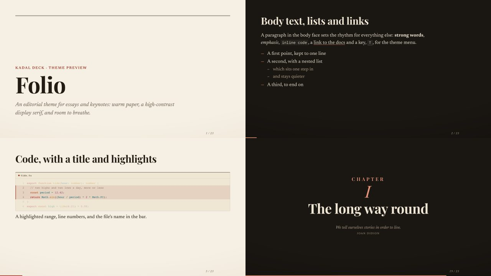

# @kadal/theme-folio

**Folio**, a theme for [Kadal Deck](https://deck.kadal.cc). An editorial theme for essays and keynotes. Warm paper and ink, Playfair Display for the display lines, Newsreader for reading text, IBM Plex Mono for code; one oxblood accent and a gilt second. Generous margins, a measure kept to reading length, booktabs tables, an asterism for a rule, small capitals for labels, a fleuron over a section.



## Use it

```bash
npm install @kadal/theme-folio
```

```yaml
---
theme: folio
themeConfig:            # all optional
  paper: "#f6f0e4"
  accent: "#9b2c1c"
  accentDark: "#e8957c"
---
```

The deck plugin brings the stylesheet and the module in; nothing to import. The prebuilt shell (the hosted builder, published decks) bundles this theme already. Schemes: light and dark. Fonts: Playfair Display (headings), Newsreader (text, `--deck-serif-font`), IBM Plex Mono (code), loaded through the theme's `config.fonts`. Code colours: Shiki's gruvbox-light-soft / gruvbox-dark-soft. To show it beside other themes in the theme menu (<kbd>T</kbd>), list it: `themes: [folio, minimal]`.

## themeConfig

Every key arrives on the deck root as a CSS variable (`accentDark` → `--theme-accent-dark`); the theme reads them with fallbacks, so set only what you change.

| key | type | default | what it does |
| --- | --- | --- | --- |
| `paper` | colour | `#f6f0e4` | The light page's colour. |
| `accent` | colour | `#9b2c1c` | The light scheme's accent (oxblood). |
| `accentDark` | colour | `#e8957c` | The dark scheme's accent. Without it, a set `accent` is lifted towards white. |

## Layouts

Every built-in layout is styled (`default`, `center`, `cover`, `intro`, `section`, `end`, `fact`, `quote`, `statement`, `full`, `two-cols`, `two-cols-header`, `image`, `image-left`, `image-right`, `iframe`, `iframe-left`, `iframe-right`), and the theme adds:

| layout | what |
| --- | --- |
| `pull-quote` | The line that carries the piece, between an accent rule and a hairline; `by:` sets the attribution. |
| `essay` | One column at reading measure with a drop cap; an `::aside::` slot becomes a note in the margin. |
| `chapter` | A chapter opener: "Chapter" and its roman numeral (counted from the deck's chapter slides, or `n:`; `label:` changes the word), the title, and an epigraph if the slide has a blockquote. |

## Components

| component | what |
| --- | --- |
| `<Byline author date place />` | Author, date and place between two hairlines, in small capitals. |
| `<Lede>…</Lede>` | The opening paragraph, larger, with a drop cap. |

## Preview

`preview/deck.mdx` walks through every layout and component (`theme: ../`). In this repository:

```bash
bun run --filter @kadal/theme-folio dev       # the preview deck, live
node tools/theme-shots.mjs folio               # screenshots in light and dark, contrast and overflow checks
```

## Accessibility and print

Body and muted text meet WCAG AA (4.5:1) on the page and on cards in every scheme the theme draws (checked by `tools/theme-shots.mjs`). Anything that moves stands still under `prefers-reduced-motion` and on a still copy; printed pages and exports drop shadows and glows.

## Licence

AGPL-3.0-or-later, like the engine (see LICENSE); a commercial licence is available — see [LICENSING](https://github.com/kadalcc/deck/blob/main/LICENSING.md).
