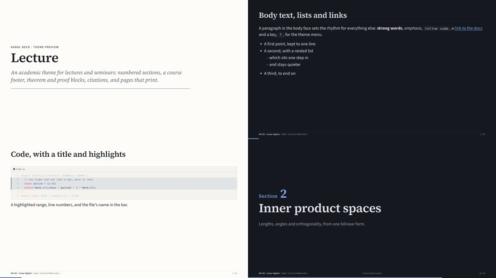

# @kadal/theme-lecture

**Lecture**, a theme for [Kadal Deck](https://deck.kadal.cc). An academic theme for lectures, seminars and defences. The Source family (Serif 4 for headings, Sans 3 for text, Code Pro for code), navy for structure and crimson for results, numbered sections, a footer on every slide, definition / theorem / proof blocks set the way a textbook sets them, citations, and a references layout. Made to print: white pages, hairlines that survive a laser printer, no shadows, the footer on every page.



## Use it

```bash
npm install @kadal/theme-lecture
```

```yaml
---
theme: lecture
themeConfig:            # all optional
  footer: true
  sectionNumbers: true
  accent: "#1f4e8c"
---
```

The deck plugin brings the stylesheet and the module in; nothing to import. The prebuilt shell (the hosted builder, published decks) bundles this theme already. Schemes: light and dark. Fonts: Source Serif 4 (headings, serif), Source Sans 3 (text), Source Code Pro (code), loaded through the theme's `config.fonts`. Code colours: Shiki's github-light / github-dark-dimmed. To show it beside other themes in the theme menu (<kbd>T</kbd>), list it: `themes: [lecture, minimal]`.

## themeConfig

Every key arrives on the deck root as a CSS variable (`accentDark` → `--theme-accent-dark`); the theme reads them with fallbacks, so set only what you change.

| key | type | default | what it does |
| --- | --- | --- | --- |
| `course` | string | — | The course, bold at the footer's left ("MA 201 · Linear Algebra"). |
| `author` | string | the deck's `author` | Who is speaking, after the course. |
| `institution` | string | — | After the author. |
| `footer` | boolean | `true` | `false` turns the footer off; `footer: false` on a slide hides it there. |
| `sectionNumbers` | boolean | `true` | `false` leaves the numbers off section slides and the footer. |
| `accent` | colour | `#1f4e8c` | The colour of the structure (headings' rules, numbers, definitions). |

## Layouts

Every built-in layout is styled (`default`, `center`, `cover`, `intro`, `section`, `end`, `fact`, `quote`, `statement`, `full`, `two-cols`, `two-cols-header`, `image`, `image-left`, `image-right`, `iframe`, `iframe-left`, `iframe-right`), and the theme adds:

| layout | what |
| --- | --- |
| `section` | The built-in section, numbered: "Section 2" over the title, counted from the deck's section slides (`n:` overrides). |
| `definition` | A slide that is one definition, large: `name:` and `n:` label it. |
| `theorem` | The same for a theorem; `kind: lemma | corollary | proposition`. |
| `references` | The slide's list as a numbered bibliography, [1] [2] …, in two columns past six entries. |

## Components

| component | what |
| --- | --- |
| `<Definition>` `<Theorem>` `<Lemma>` `<Corollary>` `<Proposition>` `<Example>` `<Remark>` | A run-in label ("Theorem 2.1 (Pythagoras).") then the body: `n` numbers it, `title` names it. A definition is a tinted box, a theorem (and lemma, corollary, proposition) a frame with the statement in italics. |
| `<Proof of>` | "Proof." (or "Proof of Theorem 2.1.") then the body, closed with ∎. |
| `<Cite n page />` | `[3]`, `[3, 7, p. 12]`; with children, author–year: `<Cite>Knuth 1984</Cite>` → (Knuth 1984). |

## Preview

`preview/deck.mdx` walks through every layout and component (`theme: ../`). In this repository:

```bash
bun run --filter @kadal/theme-lecture dev       # the preview deck, live
node tools/theme-shots.mjs lecture               # screenshots in light and dark, contrast and overflow checks
```

## Accessibility and print

Body and muted text meet WCAG AA (4.5:1) on the page and on cards in every scheme the theme draws (checked by `tools/theme-shots.mjs`). Anything that moves stands still under `prefers-reduced-motion` and on a still copy; printed pages and exports drop shadows and glows.

## Licence

AGPL-3.0-or-later, like the engine (see LICENSE); a commercial licence is available — see [LICENSING](https://github.com/kadalcc/deck/blob/main/LICENSING.md).
