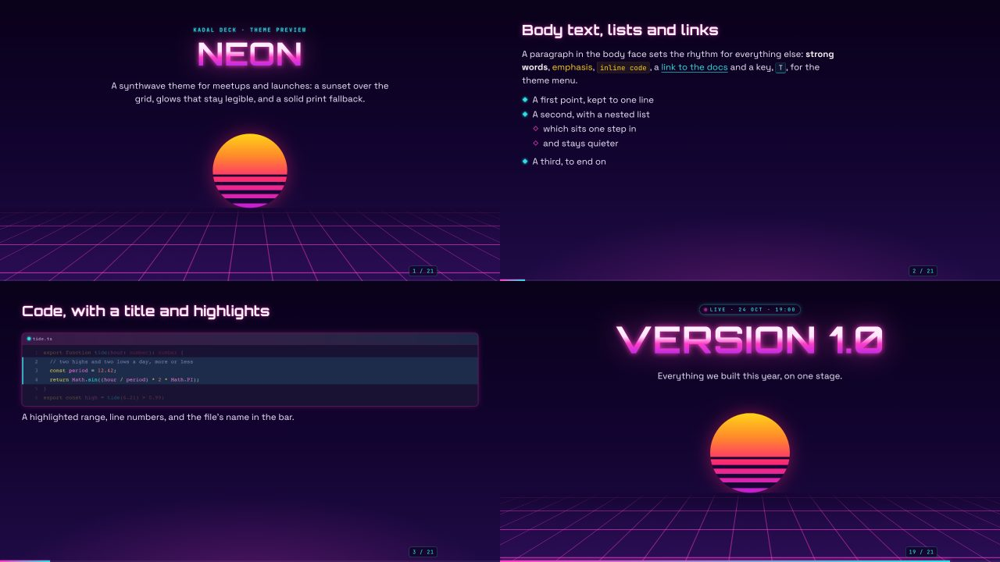

# @kadal/theme-neon

**Neon**, a theme for [Kadal Deck](https://deck.kadal.cc). A dark synthwave theme for meetups and launches. Midnight violet, a striped sunset sun over a grid that runs to the horizon, Orbitron for display, Space Grotesk for text, the Synthwave '84 code colours. The glows stay legible: the letters keep near white and only the halo takes the colour. Every glow, blur and animation is dropped on a still copy (the print view, an export, an overview tile), so a PDF gets solid colour and clean edges rather than grey halos. Dark only.



## Use it

```bash
npm install @kadal/theme-neon
```

```yaml
---
theme: neon
themeConfig:            # all optional
  primary: "#ff3ec8"
  secondary: "#2de2e6"
  grid: true
---
```

The deck plugin brings the stylesheet and the module in; nothing to import. The prebuilt shell (the hosted builder, published decks) bundles this theme already. Schemes: dark only. Fonts: Orbitron (headings), Space Grotesk (text), JetBrains Mono (code), loaded through the theme's `config.fonts`. Code colours: Shiki's synthwave-84 (both). To show it beside other themes in the theme menu (<kbd>T</kbd>), list it: `themes: [neon, minimal]`.

## themeConfig

Every key arrives on the deck root as a CSS variable (`accentDark` → `--theme-accent-dark`); the theme reads them with fallbacks, so set only what you change.

| key | type | default | what it does |
| --- | --- | --- | --- |
| `primary` | colour | `#ff3ec8` | Magenta: headings' glow, the accent. |
| `secondary` | colour | `#2de2e6` | Cyan: bullets, links, labels. |
| `grid` | boolean | `true` | `false` hides the floor grid on covers and the theme's layouts. |

## Layouts

Every built-in layout is styled (`default`, `center`, `cover`, `intro`, `section`, `end`, `fact`, `quote`, `statement`, `full`, `two-cols`, `two-cols-header`, `image`, `image-left`, `image-right`, `iframe`, `iframe-left`, `iframe-right`), and the theme adds:

| layout | what |
| --- | --- |
| `launch` | The title over the striped sun with the grid running to the horizon, and a pulsing chip above it (`chip: "Live · 24 Oct"`, or `date:`). |
| `horizon` | An ordinary content slide with the grid along its foot. |

## Components

| component | what |
| --- | --- |
| `<Glow tone>` | A word or phrase in neon: `tone` pink (default) · cyan · amber. |

## Preview

`preview/deck.mdx` walks through every layout and component (`theme: ../`). In this repository:

```bash
bun run --filter @kadal/theme-neon dev       # the preview deck, live
node tools/theme-shots.mjs neon               # screenshots in light and dark, contrast and overflow checks
```

## Accessibility and print

Body and muted text meet WCAG AA (4.5:1) on the page and on cards in every scheme the theme draws (checked by `tools/theme-shots.mjs`). Anything that moves stands still under `prefers-reduced-motion` and on a still copy; printed pages and exports drop shadows and glows.

## Licence

AGPL-3.0-or-later, like the engine (see LICENSE); a commercial licence is available — see [LICENSING](https://github.com/kadalcc/deck/blob/main/LICENSING.md).
