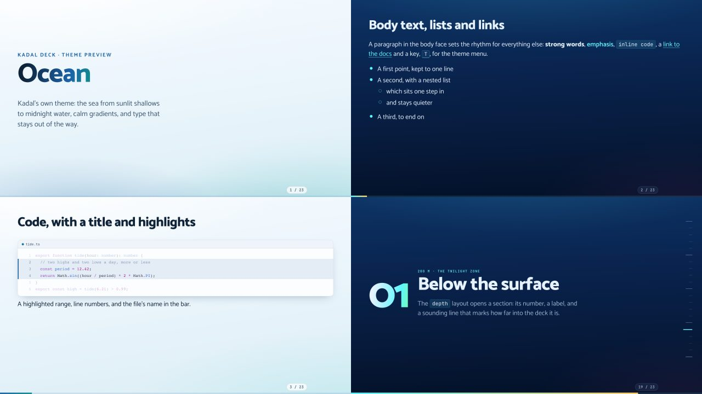

# @kadal/theme-ocean

**Ocean**, a theme for [Kadal Deck](https://deck.kadal.cc). Kadal's own theme. *Kadal* is Tamil for the sea, and the palette is the one [kadal.cc](https://kadal.cc) dives through: sunlit shallows in the light scheme (foam, sky and deep-sea ink), midnight water in the dark one (twilight blue, bioluminescent cyan, lure amber). Calm gradients for the page, Catamaran for type, Night Owl for code. Made to be a good default for a new deck.



## Use it

```bash
npm install @kadal/theme-ocean
```

```yaml
---
theme: ocean
themeConfig:            # all optional
  accent: "#1d63a8"
  accentDark: "#5ff7ff"
  waves: true
---
```

The deck plugin brings the stylesheet and the module in; nothing to import. The prebuilt shell (the hosted builder, published decks) bundles this theme already. Schemes: light and dark. Fonts: Catamaran (text and headings), JetBrains Mono (code), loaded through the theme's `config.fonts`. Code colours: Shiki's night-owl-light / night-owl. To show it beside other themes in the theme menu (<kbd>T</kbd>), list it: `themes: [ocean, minimal]`.

## themeConfig

Every key arrives on the deck root as a CSS variable (`accentDark` → `--theme-accent-dark`); the theme reads them with fallbacks, so set only what you change.

| key | type | default | what it does |
| --- | --- | --- | --- |
| `accent` | colour | `#1d63a8` | The accent in the light scheme (links, bullets, the progress bar). |
| `accentDark` | colour | `#5ff7ff` | The accent in the dark scheme. Without it, a set `accent` is lifted towards white. |
| `waves` | boolean | `true` | `false` hides the swells along the cover's foot. |

## Layouts

Every built-in layout is styled (`default`, `center`, `cover`, `intro`, `section`, `end`, `fact`, `quote`, `statement`, `full`, `two-cols`, `two-cols-header`, `image`, `image-left`, `image-right`, `iframe`, `iframe-left`, `iframe-right`), and the theme adds:

| layout | what |
| --- | --- |
| `waves` | A cover with the sea moving along the bottom edge. `align: center` centres it. The swells stand still under `prefers-reduced-motion` and in print. |
| `depth` | A section opener: its number (counted, or `n:`), a label (`depth: "200 m · twilight"`) and a sounding line down the side marking how far into the deck it is. |

## Components

| component | what |
| --- | --- |
| `<Wave />` | A single swell as a divider, in the accent colour; `flip` turns it over. |

## Preview

`preview/deck.mdx` walks through every layout and component (`theme: ../`). In this repository:

```bash
bun run --filter @kadal/theme-ocean dev       # the preview deck, live
node tools/theme-shots.mjs ocean               # screenshots in light and dark, contrast and overflow checks
```

## Accessibility and print

Body and muted text meet WCAG AA (4.5:1) on the page and on cards in every scheme the theme draws (checked by `tools/theme-shots.mjs`). Anything that moves stands still under `prefers-reduced-motion` and on a still copy; printed pages and exports drop shadows and glows.

## Licence

AGPL-3.0-or-later, like the engine (see LICENSE); a commercial licence is available — see [LICENSING](https://github.com/kadalcc/deck/blob/main/LICENSING.md).
