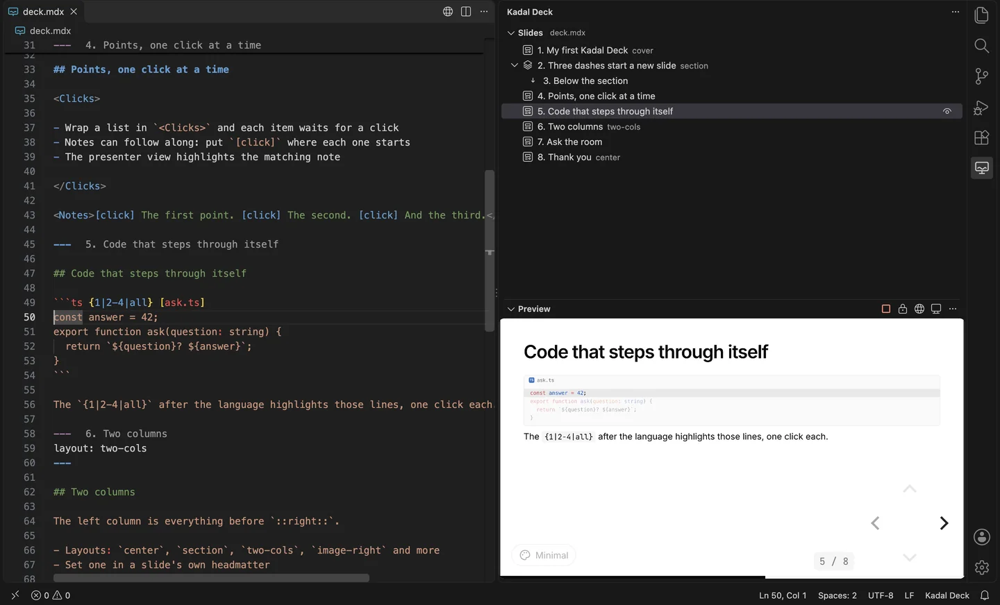
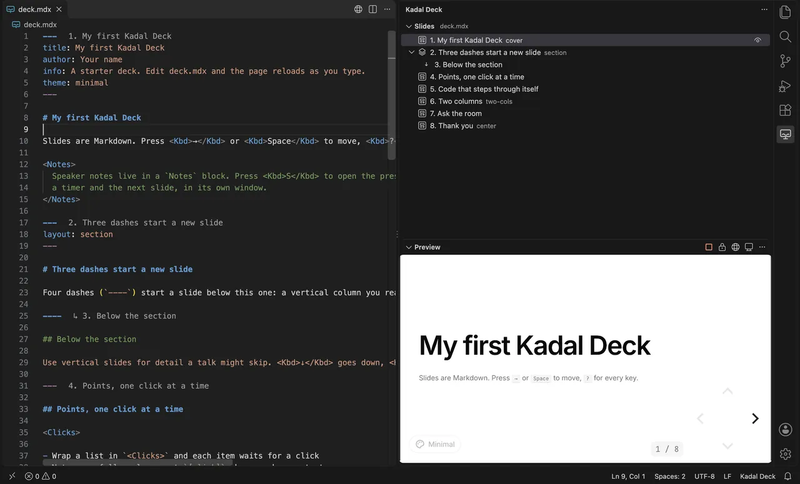
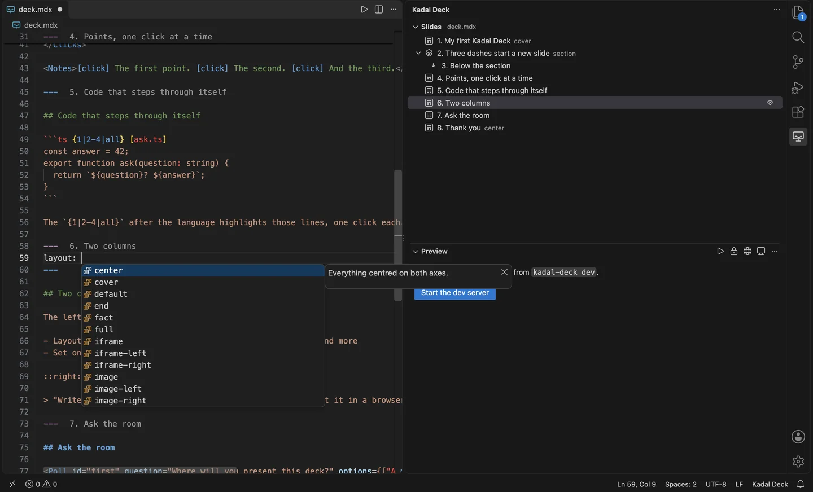
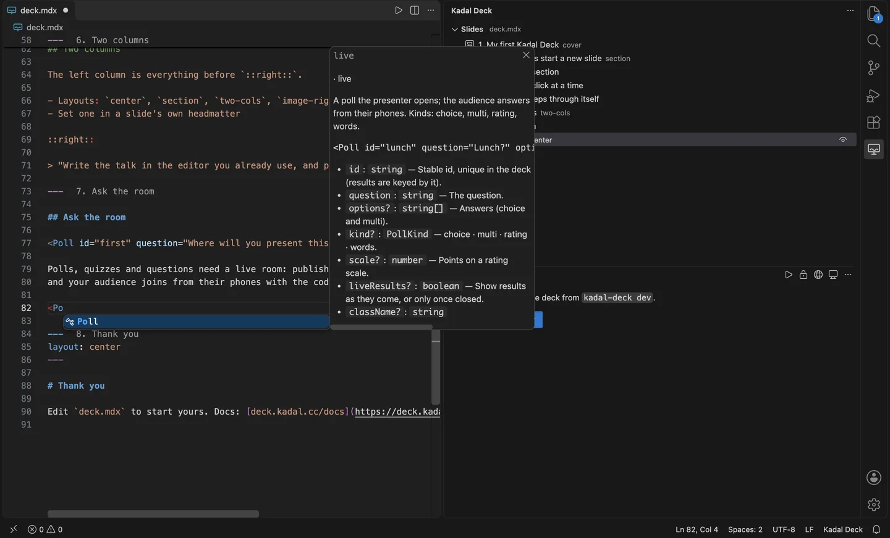

# Kadal Deck for VS Code

> **Build it. Rehearse it. Own the room.** [Kadal Deck](https://deck.kadal.cc) has your back for the whole talk, from the first idea to the last applause. This extension is where you build it, in your editor: write, see and check every slide without leaving VS Code, then rehearse and present from the same deck.
>
> [Take the tour](https://decks.kadal.cc/@pmithunish/tour/) · [Docs](https://deck.kadal.cc/docs/)

Write [Kadal Deck](https://deck.kadal.cc) presentations with the deck beside your text. A
presentation is one `deck.mdx` file: Markdown slides, split at `---`, with components when you need
them. This extension shows the slide your cursor is in, lists every slide in an outline you can
drag to reorder, completes every setting and component, and shows the deck's own checks as
problems.

## Get started

1. Make a deck, if you don't have one: run **Kadal Deck: New deck…** from the command palette, or
   `npm create @kadal/deck@latest my-talk` in a terminal. Then `npm install` in its folder.
2. Open the folder and `deck.mdx`. The Kadal Deck icon in the activity bar opens the outline and the
   preview.
3. Press the play button on the **Preview** to start `kadal-deck dev`. Move the cursor and the
   preview follows.

## Features

### A preview that follows your cursor

The **Preview** is the deck itself, served by `kadal-deck dev`, so it looks exactly like the deck
in a browser. It turns to the slide your cursor is in without reloading. Its title bar has buttons
to start or stop the dev server (or attach to one already running on the port), stop following the
cursor, open the deck in the browser at the cursor's slide, and open the presenter view. In a
remote window (SSH, a container, Codespaces) the preview goes through VS Code's port forwarding.

### An outline you can drag

The **Slides** view lists the active deck's slides, numbered the way the deck numbers them and
titled from their `title` or first heading. A vertical stack (`----`) nests under its column, and
each row shows its layout and whether it is hidden or comes from another file. Click a slide to put
the cursor on it. **Drag a slide onto another to move it there**: whole slides move with their
frontmatter and notes, every other byte of the file stays as it was, and one undo puts it back.

### IntelliSense from the engine's catalog

In the headmatter you get every deck and slide setting; in a slide's frontmatter, every slide
setting, each with its documentation, type and default. After `layout:`, `transition:`, `theme:`,
`background:` and any setting with known values, you get those values. After `<` in a slide, you get
every component, with its required props filled in as a snippet. Hover a setting or a component to
read its documentation. It all comes from the same catalog as `kadal-deck info` and the JSON Schema,
so it matches the engine version your deck uses.

### The deck's checks as problems

Saving a deck file runs `kadal-deck check` and lists what it finds in the Problems panel: unknown
layouts and settings, missing pictures and files, broken includes, glossary mistakes.
**Kadal Deck: Check the deck** also compiles every slide.

### Highlighting, folding and formatting

`deck.mdx` and `slides.mdx` open as Kadal Deck files. Separators, each slide's frontmatter (as YAML),
`<Notes>` and their `[click]` markers, `::right::` slot markers, `::code-group` blocks and
`<<< @/snippet` imports are highlighted; the rest is Markdown. Each slide folds, and its number and
title show at the end of its separator line.

**Format Document** uses the deck's own [`@kadal/prettier-plugin`](https://www.npmjs.com/package/@kadal/prettier-plugin),
which comes with `@kadal/deck`: separators and frontmatter tidied, YAML formatted with its comments
kept, every slide's Markdown formatted, and code, notes, magic-move blocks, `<style>` and slot
markers left exactly as written. Your `.prettierrc` applies.

### Tools for AI agents

In VS Code 1.101 and later, the extension offers the deck's [MCP server](https://deck.kadal.cc/docs/ai-agents/)
(`kadal-deck mcp`) to VS Code's agents, such as Copilot agent mode. Its tools outline, read, lint,
render, edit and export the active deck, so an agent can change one slide and look at the result.

## Commands

All are under **Kadal Deck:** in the command palette.

| Command | What it does |
| --- | --- |
| Start the dev server / Stop the dev server | Runs `kadal-deck dev` for the preview |
| Open the deck in the browser | At the cursor's slide |
| Open the presenter view | At the cursor's slide: notes, timer, next slide |
| Export to PDF | Runs `kadal-deck export` in a terminal |
| Check the deck | Runs `kadal-deck check`, compiling every slide |
| Format the deck | Formats the active deck file |
| New deck… | Creates a deck from the starter, in a folder you pick |
| Choose the active deck… | Picks one when the workspace has several |

## Settings

| Setting | Default | What it does |
| --- | --- | --- |
| `kadalDeck.port` | `3030` | The port the dev server uses for the preview |
| `kadalDeck.devCommand` | empty | The command that starts it. `${args}` becomes `dev --port <port> --strictPort` and `${port}` the port, as in `pnpm kadal-deck ${args}`. Empty uses the deck's own `kadal-deck`, or else `npx -p @kadal/deck kadal-deck` |
| `kadalDeck.preview.followCursor` | `true` | The preview shows the slide the cursor is in |
| `kadalDeck.check.onSave` | `true` | Runs `kadal-deck check` when a deck file is saved |
| `kadalDeck.annotations` | `true` | Shows each slide's number and title beside its separator |
| `kadalDeck.include` | `**/deck.mdx`, `**/slides.mdx` | Which files are decks |

## Requirements

- VS Code 1.90 or later (1.101 or later for the MCP server).
- Node 20.19 or later, and a deck folder with `@kadal/deck` installed. `npm create @kadal/deck`
  makes one.

The extension reads and edits decks with the engine code it carries, and it builds, serves,
checks and formats them with the deck's own CLI and packages, so it always agrees with the engine
version the deck uses.

## Links

- [Kadal Deck docs](https://deck.kadal.cc/docs/) and [getting started](https://deck.kadal.cc/docs/getting-started/)
- [The tour](https://decks.kadal.cc/@pmithunish/tour/): every feature of the engine on one deck
- [Themes](https://deck.kadal.cc/themes/)
- [Issues](https://github.com/kadalcc/deck/issues) and [Discussions](https://github.com/kadalcc/deck/discussions)
- [Source](https://github.com/kadalcc/deck/tree/main/packages/vscode)

## Licence

AGPL-3.0-or-later, like the engine. See [LICENSING.md](https://github.com/kadalcc/deck/blob/main/LICENSING.md).
