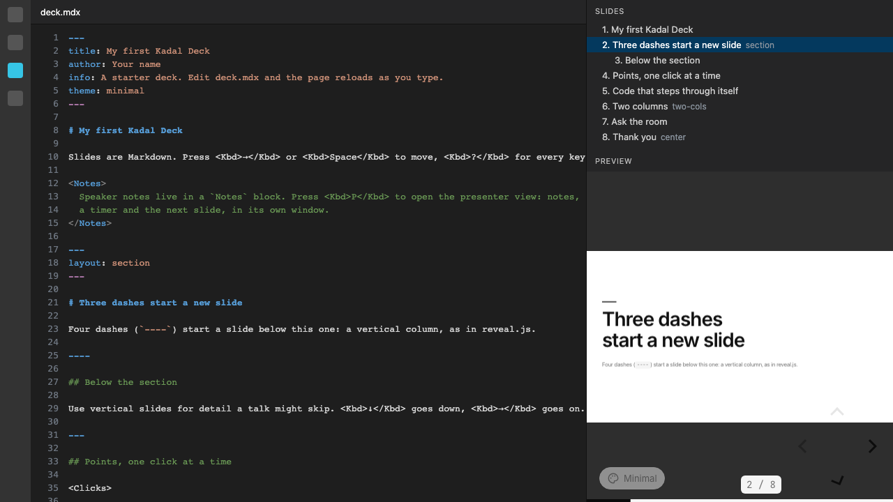

# Kadal Deck for VS Code

Write [Kadal Deck](https://deck.kadal.cc/docs/) presentations with the deck beside your text: a live preview that follows your cursor, an outline you can drag to reorder, IntelliSense for every setting and component, the deck's own checks as problems, and formatting.

The deck file as the extension's grammar colours it (Dark+), the Slides outline, and the Preview: the deck from `kadal-deck dev`. Composed for this page from the extension's grammar, the starter deck's real outline and the real dev server.

## What it does

**Slides.** The Kadal Deck icon in the activity bar opens the active deck's outline. Slides are numbered as the deck numbers them and titled from their `title` or first heading; a vertical stack (`----`) nests under its column. Each row says its layout, and whether it is hidden or comes from another file. Click a slide to put the cursor on it; **drag a slide onto another to move it there** (into that slide's stack when it is in one). A move is the engine's own `moveSlide`: whole slides with their frontmatter and notes, every other byte of the file kept, one undo step.

**Preview.** The deck itself, from `kadal-deck dev`, follows the slide your cursor is in, without reloading. The play button starts the dev server (or attaches to one already running on the port, say in a terminal); the globe opens the deck in the browser at the cursor's slide, the screen opens the presenter view. The lock stops the preview following the cursor. In a remote window (SSH, a container, Codespaces) the preview goes through VS Code's port forwarding.

**Language.** `deck.mdx` and `slides.mdx` open as Kadal Deck: separators (`---`, `----`), the headmatter and each slide's frontmatter (as YAML), `<Notes>` and HTML-comment notes with their `[click]` markers, `::right::` slot markers, `::code-group` blocks and `<<< @/snippet` imports are highlighted; the rest is Markdown. Each slide folds, and shows its number and title at the end of its separator line.

**IntelliSense.** In the headmatter, every deck setting and slide setting; in a slide's frontmatter, every slide setting — each with its documentation, type and default. After `layout: `, `transition: `, `theme: `, `background: ` and any setting with known values, those values. After `<` in a slide, every component, with its required props as a snippet. Hover a setting or a component for its documentation. It all comes from the engine's catalog, the same data `kadal-deck info` and the JSON Schema are made from.

**Problems.** Saving a deck file runs `kadal-deck check` and shows what it finds — unknown layouts and settings, missing assets, broken includes, glossary mistakes — in the Problems panel. **Kadal Deck: Check the deck** also compiles every slide.

**Formatting.** Format Document uses the deck's own `@kadal/prettier-plugin` (it comes with `@kadal/deck`): separators and frontmatter tidied, the YAML formatted with its comments, every slide's Markdown formatted, and code, notes, magic-move, `<style>` and `::slot::` sugar left exactly as written. Your `.prettierrc` applies.

**AI.** In VS Code 1.101 and later the extension offers the deck's `kadal-deck mcp` server to VS Code's agents (Copilot agent mode and others): tools to outline, read, lint, render, edit and export the active deck.

## Commands

All under **Kadal Deck:** in the command palette.

| Command | |
|---|---|
| Start the dev server / Stop the dev server | `kadal-deck dev` for the preview |
| Open the deck in the browser | at the cursor's slide |
| Open the presenter view | at the cursor's slide |
| Export to PDF | `kadal-deck export` in a terminal |
| Check the deck | `kadal-deck check`, every slide compiled |
| Format the deck | the active deck file |
| New deck… | a deck from the starter, in a folder you pick |
| Choose the active deck… | when the workspace has several |

## Settings

| Setting | Default | |
|---|---|---|
| `kadalDeck.port` | `3030` | The dev server's port for the preview |
| `kadalDeck.devCommand` | | The command that starts it: `${args}` becomes `dev --port <port> --strictPort`, `${port}` the port (`pnpm kadal-deck ${args}`). Empty: the deck's own `kadal-deck`, else `npx -p @kadal/deck kadal-deck` |
| `kadalDeck.preview.followCursor` | `true` | The preview shows the cursor's slide |
| `kadalDeck.check.onSave` | `true` | `kadal-deck check` on save |
| `kadalDeck.annotations` | `true` | Each slide's number and title beside its separator |
| `kadalDeck.include` | `**/deck.mdx`, `**/slides.mdx` | Which files are decks |

## Requirements

A deck folder with `@kadal/deck` installed (`npm create @kadal/deck` makes one). The extension reads and edits decks with the engine's code it carries; it builds, serves, checks and formats them with the deck's own CLI and packages, so it always agrees with the engine version the deck uses.

## Licence

AGPL-3.0-or-later, like the engine. [Source](https://github.com/kadalcc/deck/tree/main/packages/vscode).
